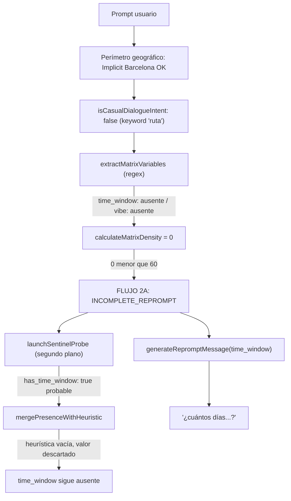

# [ARQUITECTURA] Auditoría de Falso Negativo de `time_window` en Triaje ante Franja Horaria Explícita

**Identificador:** AUD-TRIAGE-TW-001  
**Fecha de Incidente:** 2026-10-12 (18:12:41 CEST)  
**Fecha de Auditoría:** 2026-10-12 (18:15 – 18:20 CEST)  
**Commit Auditado:** `4222e6d`  
**Módulo Afectado:** `src/features/triage/` · `src/features/ai-engine/groq/prompts/`  
**Auditor:** Google Antigravity (Anthropic Claude Opus) & Vértice Biológico (Racso)  
**Estado:** 🔴 **ABIERTO** — Diagnóstico concluido, remediación pendiente  
**Marco Normativo:** Protocolo de Acero — Grado S+ · [`CONSTITUTION.md`](file:///home/racso/Proyectos/BarcelonaXplorer/CONSTITUTION.md) · [Anexo Constitucional: Axiomas de Forja S+ Grade](file:///home/racso/Proyectos/BarcelonaXplorer/.SddIA/library/norms/%5BARQUITECTURA%5D%20Anexo%20Constitucional:%20Axiomas%20de%20Forja%20S+%20Grade%20%28Optimizaci%C3%B3n%20para%20IA%29.md)

---

## 1. Resumen Ejecutivo

El usuario pidió una ruta con una franja horaria explícita (19:00–23:00) y dos condiciones de contenido (cena de tapeo y actividades al aire libre). La Aduana de Triaje devolvió `INCOMPLETE_REPROMPT` con **score 0 %** y variable crítica `time_window`. Después, el SLM conversacional preguntó **cuántos días** iba a durar la ruta.

**Causa raíz:** la extracción heurística de variables (expresiones regulares incrustadas en `extractMatrixVariables`) no reconoce horas de reloj ni rangos horarios. Tampoco reconoce `tapeo`, `cena` ni `aire libre`. El Centinela Jev (LLM) no puede compensarlo por diseño: solo *confirma o veta* lo que extrajo la heurística, nunca *aporta* un valor.

---

## 2. Caso Reproducido

### 2.1 Interacción registrada

| Hora (CEST) | Actor | Contenido |
| :---: | :---: | :--- |
| 18:12:41 | Usuario | `Presentame una ruta desde las 19:00 hasta las 23, que incluya cena de tapeo y actividades al aire libre` |
| 18:12:4x | Sistema (UI) | `Matriz incompleta (0%). Variable crítica: time_window` |
| 18:12:4x | SLM (Groq) | `Me encanta la idea de tapeo nocturno, pero ¿podrías confirmarme cuántos días tienes para disfrutar de esa ruta?` |

### 2.2 Comportamiento esperado vs. obtenido

| Aspecto | Esperado | Obtenido |
| :--- | :--- | :--- |
| `time_window` | `19:00–23:00` (presente, peso 60) | ausente |
| `vibe` | `tapeo` / `cena` / `aire libre` (peso 15) | ausente |
| Score matriz `default` | ≥ 60 (umbral) | **0** |
| Estado del outcome | `DISPATCH_READY` + ruta forjada | `INCOMPLETE_REPROMPT` |
| Repregunta | ninguna | pregunta incoherente sobre "días" |

### 2.3 Reproducción determinista

Ejecución literal de las regex de producción sobre el prompt del usuario:

```bash
node -e '
const p="Presentame una ruta desde las 19:00 hasta las 23, que incluya cena de tapeo y actividades al aire libre";
const t=/\b(\d+\s*(horas?|h|d[ií]as?)|todo el \w+|por la (ma[ñn]ana|tarde|noche)|fin de semana|s[aá]bado|domingo|hoy|ma[ñn]ana|(el|del|durante el)\s*d[ií]a|durante el d[ií]a)\b/i;
const v=/\b(modernis\w+|g[oó]tico|tapas|gastronom\w+|comida|restauran\w+|fiesta|nocturn\w+|cultural|relax|playa|deport\w+|m[uú]sic\w+|espect[aá]cul\w+|ocio|arte|museo\w*)\b/i;
console.log({time:t.test(p), vibe:p.match(v), group:/\b(\d+)\s*(personas?|amigos?|pax)\b/i.test(p)});'
```

**Salida:** `{ time: false, vibe: null, group: false }` → score 0 / 60. Coincide con lo observado.

---

## 3. Traza del Flujo de Ejecución



---

## 4. Hallazgos

### H1 — 🔴 Crítico · La regex de `time_window` no reconoce horas de reloj ni rangos

- **Ubicación:** [triage-input.use-case.ts:L806-L816](file:///home/racso/Proyectos/BarcelonaXplorer/src/features/triage/triage-input.use-case.ts#L806-L816)
- **Detalle:** solo reconoce `N horas/h/días`, `todo el X`, `por la mañana/tarde/noche`, `fin de semana`, `sábado/domingo`, `hoy/mañana` y `el/del/durante el día`. No cubre:
  - horas de reloj: `19:00`, `21h`, `a las 10`;
  - rangos: `desde las X hasta las Y`, `de 19 a 23`, `entre las X y las Y`;
  - franjas sueltas: `esta noche`, `esta tarde`, `noche`, `tarde`.
- **Impacto:** `time_window` pesa 60 %, igual que el umbral de supervivencia. **Con solo este fallo corregido, el prompt del incidente se habría despachado.** Cualquier petición con franja horaria explícita que no contenga otra palabra clave cae al 0 %.

### H2 — 🟠 Alto · Léxico de `vibe` incompleto

- **Ubicación:** [triage-input.use-case.ts:L836-L844](file:///home/racso/Proyectos/BarcelonaXplorer/src/features/triage/triage-input.use-case.ts#L836-L844)
- **Detalle:** incluye `tapas` pero no `tapeo`, `tapear`, `cena`, `cenar`, `aire libre`, `exterior`, `parque`, `mirador`. La palabra `nocturn\w+` sí está, pero el usuario no la usó.
- **Impacto:** el score real fue 0 % en lugar de 15 %.

### H3 — 🟠 Alto · El Centinela Jev no puede rescatar variables que la heurística no ve

- **Ubicación:** [merge-presence-with-heuristic.ts:L33-L38](file:///home/racso/Proyectos/BarcelonaXplorer/src/features/triage/merge-presence-with-heuristic.ts#L33-L38) · [triage-input.use-case.ts:L569-L576](file:///home/racso/Proyectos/BarcelonaXplorer/src/features/triage/triage-input.use-case.ts#L569-L576)
- **Detalle:**
  1. La sonda (`DensityPresenceSentinel`) solo se lanza en el camino `< 60 %`, en segundo plano y **después** de emitir la repregunta. No influye en el turno actual.
  2. Aunque `has_time_window` sea `true`, la fusión solo acepta `heuristic.time_window` si no está vacío. Sonda positiva con heurística vacía ⇒ se retiene `prior.time_window` (undefined).
- **Impacto:** el LLM funciona como **veto** pero nunca como **fuente**. La sonda tampoco ayuda en los turnos siguientes: el prompt original queda sin valor persistido.

### H4 — 🟡 Medio · Repregunta incoherente con la intención del usuario

- **Ubicación:** [conversational-reprompt.prompt.ts:L7-L34](file:///home/racso/Proyectos/BarcelonaXplorer/src/features/ai-engine/groq/prompts/conversational-reprompt.prompt.ts#L7-L34)
- **Detalle:** el system prompt no prohíbe preguntar por datos que ya están en la intención. La etiqueta de la variable (`horas, días o momentos del día`) invita al modelo a elegir "días". El SLM recibe la orden de pedir `time_window` aunque el usuario lo haya dado, así que alucina una dimensión alternativa.
- **Impacto:** degrada la confianza del usuario, que percibe que el sistema no lee su mensaje.

### H5 — 🟡 Medio · Infracción del Axioma III y ausencia de cobertura de regresión

- **Detalle:** la extracción es una cadena imperativa de `if` + regex incrustada en el caso de uso, no una matriz declarativa de patrones. Ningún test de `triage.test.ts` ni de `triage-input.live.test.ts` cubre horas de reloj ni rangos horarios.
- **Axioma afectado:** III (Diseño Declarativo sobre Lógica Imperativa). Indirectamente IV: el oráculo `vitest` pasa en verde porque no hay un caso que lo contradiga.

---

## 5. Matriz de Impacto

| Hallazgo | Severidad | Bloquea despacho | Afecta UX | Axioma |
| :---: | :---: | :---: | :---: | :---: |
| H1 | 🔴 Crítico | ✅ | ✅ | III |
| H2 | 🟠 Alto | ❌ (aislado) | ✅ | III |
| H3 | 🟠 Alto | ✅ (como red de seguridad) | ✅ | V (contrato de fusión) |
| H4 | 🟡 Medio | ❌ | ✅ | — |
| H5 | 🟡 Medio | — | — | III · IV |

---

## 6. Recomendaciones de Remediación

| # | Acción | Hallazgos | Ubicación propuesta |
| :---: | :--- | :---: | :--- |
| R1 | Extraer los patrones a una **matriz declarativa tipada** (`{ variable, pattern, resolve }`) e incluir horas de reloj, rangos (`desde/hasta`, `de…a`, `entre…y`) y franjas (`esta noche`, `noche`, `tarde`). | H1 · H5 | `src/features/triage/matrix-extraction-patterns.ts` |
| R2 | Ampliar el léxico de `vibe`: `tapeo`, `tapear`, `cena`, `cenar`, `aire libre`, `exterior`, `parque`, `mirador`. | H2 | Misma matriz de R1 |
| R3 | Corregir la fusión: si `probe.has_time_window === true` y la heurística está vacía, usar el prompt crudo como `time_window` (misma semántica que la heurística actual, L814). Estudiar un join síncrono acotado en el camino `< 60 %` cuando el único faltante crítico es `time_window`. | H3 | `merge-presence-with-heuristic.ts` |
| R4 | Añadir al system prompt de repregunta la directriz: *"No preguntes por datos que ya aparezcan en la intención del explorador"*, y ajustar la etiqueta de `time_window` según la granularidad. | H4 | `conversational-reprompt.prompt.ts` |
| R5 | Tests de regresión colocalizados con el prompt literal de este incidente y variantes (`de 17 a 20`, `a las 10`, `esta noche`). | H5 | `src/features/triage/matrix-extraction-patterns.test.ts` |

**Criterio de cierre:** el prompt del incidente produce `DISPATCH_READY` con `time_window` y `vibe` presentes, y la Santa Trinidad de Oráculos queda en verde (`tsc --noEmit` · `eslint` · `vitest run`).

---

## 7. Referencias

- [triage-input.use-case.ts](file:///home/racso/Proyectos/BarcelonaXplorer/src/features/triage/triage-input.use-case.ts)
- [merge-presence-with-heuristic.ts](file:///home/racso/Proyectos/BarcelonaXplorer/src/features/triage/merge-presence-with-heuristic.ts)
- [density-presence-sentinel.use-case.ts](file:///home/racso/Proyectos/BarcelonaXplorer/src/features/triage/density-presence-sentinel.use-case.ts)
- [matrix.ts](file:///home/racso/Proyectos/BarcelonaXplorer/src/features/planner/matrix.ts) (pesos: `time_window` 60 · `group_size` 15 · `vibe` 15 · `constraints` 10 · umbral 60)
- [conversational-reprompt.prompt.ts](file:///home/racso/Proyectos/BarcelonaXplorer/src/features/ai-engine/groq/prompts/conversational-reprompt.prompt.ts)
- Auditoría relacionada: [AUD-MEM-LOC-001](file:///home/racso/Proyectos/BarcelonaXplorer/Documentacion/Auditorias/Auditoria%20-%20Comportamiento%20de%20Memoria%20de%20Usuario%20e%20Interaccion%20Local.md)
