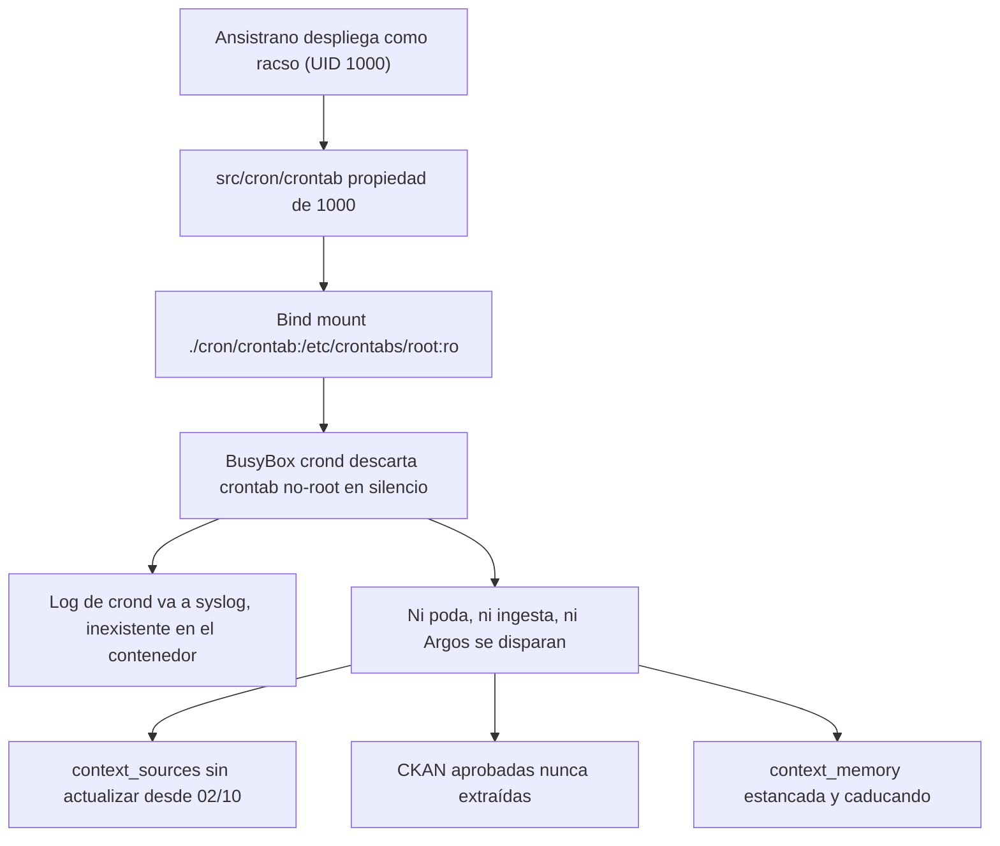

# [OPERATIVO] Auditoría de Inanición de la Ingesta de Contexto en Producción (Sidecar Cron Inerte)

**Identificador:** AUD-OPS-CRON-001  
**Fecha de Auditoría:** 2026-10-13 (07:08 – 07:12 CEST)  
**Nodo Auditado:** `10.0.10.11` (`nodos_pro` / PC 11)  
**Release Activa:** `releases/20261012160541Z` (contenedores creados 2026-10-12 16:08 UTC)  
**Commit de Referencia:** `4222e6d`  
**Auditor:** Google Antigravity (Anthropic Claude Opus) & Vértice Biológico (Racso)  
**Revisión complementaria:** 2026-10-13 — contraste con BusyBox 1.36.1 (`miscutils/crond.c`, tag `1_36_1`) y con el código del repositorio  
**Estado:** 🔴 **ABIERTO**. Causa raíz confirmada por experimento y por el fuente de `crond`; remediación en [PBI-CTX-030](file:///home/racso/Proyectos/BarcelonaXplorer/Documentacion/PBI/Pendiente/PBI%20-%20Kaizen%20de%20Ignici%C3%B3n%20del%20Sidecar%20Cron%20y%20Alarma%20de%20Inanici%C3%B3n%20de%20Ingesta%20%28P1%29.md)  
**Marco Normativo:** Protocolo de Acero — Grado S+ · [`CONSTITUTION.md`](file:///home/racso/Proyectos/BarcelonaXplorer/CONSTITUTION.md) · [Anexo Constitucional: Axiomas de Forja S+ Grade](file:///home/racso/Proyectos/BarcelonaXplorer/.SddIA/library/norms/%5BARQUITECTURA%5D%20Anexo%20Constitucional:%20Axiomas%20de%20Forja%20S+%20Grade%20%28Optimizaci%C3%B3n%20para%20IA%29.md)

---

## 1. Resumen Ejecutivo

El panel `/Admin/Context` muestra el 2/10 como última bitácora de las fuentes, o "sin historial". La Memoria Vectorial Hiperlocal tiene muy pocos registros.

**Causa raíz:** el sidecar `barcelonaxplorer_cron` **no ha ejecutado ningún trabajo en producción**. El crontab montado en `/etc/crontabs/root` pertenece al UID `1000`, el usuario del host que despliega. BusyBox `crond` 1.36.1 solo carga el fichero si `st_uid == 0` y, si no coincide, **no escribe ninguna línea de log** (ni a syslog). El arranque del demonio, además, va a syslog (`-l` sin `-d` ni `-L`) y el contenedor no tiene `syslogd`, así que `docker logs` queda vacío.

Todo el contexto vectorial actual procede de las **dos ingestas manuales del 2026-10-02**, lanzadas durante la resolución de [AUD-OPS-DEPLOY-002](file:///home/racso/Proyectos/BarcelonaXplorer/Documentacion/Auditorias/Auditoria%20-%20Fricciones%20de%20Despliegue%20en%20Produccion%20y%20Ausencia%20de%20Admin%20Context%20%28HU-18%29.md). Las cinco fuentes CKAN aprobadas el 2026-10-12 no se han extraído nunca.

---

## 2. Evidencias

### 2.1 Catálogo `context_sources` (MySQL PRO)

| `sourceTag` | Tipo | Estado | `lastSuccessAt` (UTC) | `lastErrorAt` |
| :--- | :---: | :---: | :---: | :---: |
| `bcn-festes-laborals` | ICAL | ACTIVE | 2026-10-02 18:54:03 | — |
| `bcn-opendata-ckan` | API_REST | ACTIVE ⚠️ | 2026-10-02 18:54:09 | — |
| `beteve-agenda-cultural` | RSS | ACTIVE | 2026-10-02 18:54:12 | — |
| `gencat-agenda-cultural` | SOCRATA | ACTIVE | 2026-10-02 18:54:18 | — |
| `gencat-equipaments-culturals` | SOCRATA | ACTIVE | 2026-10-02 18:54:27 | — |
| `wikidata-barcelona-monuments` | SPARQL | ACTIVE | 2026-10-02 18:54:35 | — |
| `bcn-agenda-cultural` | CKAN_DATASTORE | ACTIVE | **NULL** | — |
| `bcn-agenda-diaria` | CKAN_DATASTORE | ACTIVE | **NULL** | — |
| `bcn-agenda-esportiva` | CKAN_DATASTORE | ACTIVE | **NULL** | — |
| `bcn-mercats-municipals` | CKAN_DATASTORE | ACTIVE | **NULL** | — |
| `bcn-espais-verds` | CKAN_DATASTORE | ACTIVE | **NULL** | — |

Ninguna fila tiene `lastErrorAt` ni `failedAttempts > 0`. La ingesta no ha *fallado*: **no ha llegado a ejecutarse**.

### 2.2 Telemetría (`TelemetryLog`)

- Solo hay dos `CONTEXT_INGESTION_SUMMARY` en toda la tabla: 2026-10-02 18:48 (0 persistidos) y 18:54 (**101 persistidos**, 4 descartados por fallback).
- No hay ninguna entrada de poda (`/api/telemetry/prune`, 03:30 UTC) ni de Argos (`/api/context/maintain`). La tabla conserva registros desde el 2026-09-22, lo que confirma que la poda tampoco corre.
- No hay ningún registro entre 2026-10-12 19:25 UTC y la auditoría, aunque el nodo estuvo encendido a las 03:30 y 04:00 UTC del 13/10 (apagado a las 04:58 UTC).

### 2.3 Sidecar cron

```
$ docker logs barcelonaxplorer_cron        → (vacío desde su creación, 2026-10-12 16:08 UTC)
$ docker exec barcelonaxplorer_cron ls -la /etc/crontabs
-rw-r--r--    1 1000     1000    1551 Oct 12 10:05 root      ← propietario UID 1000
```

Conectividad y secreto verificados desde el sidecar:

- `wget http://web:3000/api/telemetry/prune` sin cabecera → `401 Unauthorized`. Hay red y DNS hacia `web`, y la aduana responde.
- `CRON_SECRET` presente en el entorno del contenedor.
- El crontab no tiene finales de línea CRLF.

### 2.4 Experimento de confirmación (contenedores efímeros `alpine:3.20` en el nodo PRO)

Se ejecutó el mismo trabajo `* * * * * echo TICK-$(id -u) > /proc/1/fd/1 2>&1` con `crond -f -d 8` durante 125 s, en dos variantes:

| Variante | Propietario de `/etc/crontabs/root` | Resultado |
| :--- | :---: | :--- |
| A — bind mount `:ro` (igual que en producción) | UID 1000 | `crond started`, **0 ejecuciones** |
| B — copia con `chown root:root` | UID 0 | 2 ejecuciones · `TICK-0` en `docker logs` |

Los contenedores de prueba se eliminaron al terminar. La pila productiva no se tocó.

### 2.5 Memoria Vectorial (`LanceDB: context_memory`)

| Métrica | Valor |
| :--- | ---: |
| Filas actuales | **77** |
| Filas ya caducadas (`expiresAt < now`) pendientes de purga | 21 |
| Persistidas en la ingesta del 02/10 | 101 |

Reparto por fuente: `gencat-equipaments-culturals` 20 · `wikidata-barcelona-monuments` 16 · `beteve-agenda-cultural` 15 · `bcn-festes-laborals` 10 · `bcn-opendata-ckan` 10 · `gencat-agenda-cultural` 6 · fuentes CKAN **0**.

El contador de telemetría (101 persistidos) y el censo actual (77 filas) no describen una segunda pérdida. `upsert` cuenta escrituras, no filas únicas: el mismo `id` repetido en aquel ciclo no suma una fila nueva. De las 77, 21 siguen caducadas porque la purga (`delete { expiredBefore }`) solo corre al final de `IngestContextUseCase.execute` y ese método no ha vuelto a entrar.

---

## 3. Cadena Causal



---

## 4. Hallazgos

### H1 — 🔴 Crítico · Crontab descartado por propiedad no-root

- **Ubicación:** [docker-compose.yml:L92-L102](file:///home/racso/Proyectos/BarcelonaXplorer/src/docker-compose.yml#L92-L102)
- **Detalle:** el volumen `./cron/crontab:/etc/crontabs/root:ro` conserva el UID del host (1000). BusyBox `crond` solo carga crontabs propiedad de `root`, y es la imagen fijada por PBI-CTX-003. Al ser `:ro`, tampoco es posible un `chown` dentro del contenedor.
- **Impacto:** los tres trabajos programados (poda, ingesta y Argos) están inertes desde que existe el sidecar en PRO.
- **Precisión del fuente (BusyBox 1.36.1, `load_crontab`):** la carga entra solo en `if (fstat(...) == 0 && sbuf.st_uid == DAEMON_UID)`. No hay rama `else` ni `crondlog`. El modo `0644` no participa en la decisión: el único cerrojo es el UID. `chmod` sin `chown root` no enciende el planificador. El nombre del fichero tiene que ser un usuario real (`getpwnam("root")`); el fichero actual cumple esa parte.

### H2 — 🔴 Crítico · Fallo silencioso: la observabilidad de PBI-CTX-029 no cubre al propio `crond`

- **Detalle:** PBI-CTX-029 redirigió la salida de los *trabajos* a `/proc/1/fd/1`, pero ese camino solo se usa si el trabajo llega a ejecutarse. El comando de producción es `["crond", "-f", "-l", "2"]`. En BusyBox 1.36.1, `-l N` solo baja el umbral de log; el destino sigue siendo syslog salvo que se pase `-d` (stderr) o `-L FILE`. El contenedor no tiene `syslogd`. El experimento de §2.4 usó `-d 8`, por eso allí sí apareció `crond started`. Con el flag de producción, esa línea tampoco sale.
- **Límite de R2:** aunque el demonio pase a `-L /dev/stdout`, el descarte por UID **sigue sin mensaje**. Ver `crond started` no demuestra que el crontab se haya cargado. La prueba que sí falla el despliegue es el `stat` de UID (R4).
- **Impacto:** 10 días sin ingesta sin que ningún sistema lo detectara. Lo descubrió el Vértice Biológico al revisar el panel. No hay alarma de inanición.

### H3 — 🟠 Alto · Volumen de memoria limitado por diseño, además de la inanición

- **Detalle:**
  - `MAX_NEW_ENTRIES_PER_SOURCE = 20` ([ingest-context.use-case.ts:L135](file:///home/racso/Proyectos/BarcelonaXplorer/src/features/context-sources/ingest-context.use-case.ts#L135)). Con 6 fuentes y un solo ciclo, el techo es 120. Los 101 persistidos encajan con ese límite (6 × 20 − truncados − 4 fallback).
  - El tope está pensado para *acumular* a lo largo de ciclos diarios. Sin cron, el corpus nunca pasa del primer lote.
  - La caducidad higiénica (`delete { expiredBefore }` en `ingest-context.use-case.ts`, paso 7) solo corre al terminar un ciclo completo. Por eso hay 21 filas vencidas visibles en el panel.
  - `LanceDbContextRetrievalAdapter.search` descarta `expiresAt <= now` antes de devolver contexto (`notExpired` por defecto). Esas 21 filas no entran en el prompt. El efecto residual sobre el RAG es el margen de la búsqueda: se piden `max(limit * 3, 10)` vecinos y, si los más próximos están caducados, los vigentes pueden quedar fuera del recorte.
- **Impacto:** corpus pobre y cada vez más obsoleto. El panel enseña filas que el generador ya no usa. El tope de 20 no se toca: está pensado para acumular un ciclo al día, y vuelve a tener sentido en cuanto el sidecar dispare.

### H4 — 🟡 Medio · Tope de lectura del panel

- **Ubicación:** [ContextMemoryCard.tsx:L30](file:///home/racso/Proyectos/BarcelonaXplorer/src/app/Admin/Context/ContextMemoryCard.tsx#L30) · [context-admin.service.ts:L54](file:///home/racso/Proyectos/BarcelonaXplorer/src/features/context-sources/context-admin.service.ts#L54)
- **Detalle:** `listMemoryEntries(100)` hace `table.query().limit(100)` sin orden ni `countRows()`. La tarjeta pinta `Total: {entries.length}` y el subtítulo dice «Registros vigentes», mientras la tabla no distingue `expiresAt < now`. Hoy 77 < 100, así que el recorte no oculta filas; el rótulo ya es falso respecto de las 21 caducadas. Cuando el corpus pase de 100, «Total» seguirá siendo el tamaño de la página y el orden de LanceDB no garantiza que las caducadas queden fuera de esa página.

### H5 — 🟡 Medio · Divergencia semilla ↔ catálogo en `bcn-opendata-ckan`

- **Detalle:** la semilla declara `status: "INACTIVE"` desde PBI-CTX-012. `upsertFromSeed` no pisa `status` de una fila ya existente, y el cierre previsto era un `DEACTIVATE` humano. Ese acto no consta en PRO: la fila sigue `ACTIVE` y aporta 10 vectores de catálogo (`package_search`). PBI-CTX-029 §6 dejó la reactivación fuera de alcance, en línea con la semilla; no ordenó apagar la fila viva. La purga `purge-ckan-corpus.ts` existe y no se ha aplicado sobre estas 10 filas.
- **Impacto:** en el primer ciclo que sí dispare, la fuente genérica volverá a ingerir fichas de dataset junto a las cinco CKAN Datastore. El `APPROVE` de esas cinco ya está en el catálogo (`ACTIVE`, `lastSuccessAt` NULL): la mutación de `APPROVE` no escribe `lastSuccessAt`, así que NULL significa «aprobada y nunca extraída», no «sigue en `PENDING_APPROVAL`». El CA-5 de PBI-CTX-029 sigue sin marcar en el documento; el catálogo de PRO es la evidencia de que el acto ocurrió.

### H6 — 🟡 Medio · Infracción del Axioma IV en el cierre de PBI-CTX-003 / PBI-CTX-029

- **Detalle:** ambos PBI se cerraron con oráculos estáticos (`tsc`, `eslint`, `vitest`) y sin ninguna verificación en el entorno real de que `crond` dispara. PBI-CTX-003 certificó la propagación de `CRON_SECRET` al proceso hijo (CA-4) y fijó el montaje `:ro` sobre `/etc/crontabs/root`. PBI-CTX-029 §5 delegó la comprobación al "primer cron posterior al APPROVE", y ese cron no puede ocurrir. `set_env_vars` en BusyBox solo fija `LOGNAME`, `USER`, `HOME`, `SHELL` y `PATH`; no hace `clearenv()`, así que el secreto del `env_file` sigue disponible para el hijo cuando el crontab llegue a cargarse. No hace falta reabrir esa propagación: hace falta un oráculo que falle si el UID del fichero cargado no es 0.

### H7 — 🟠 Alto · El nodo encendido no recupera un disparo perdido, y esta vez no fue la causa

- **Detalle:** el 13/10 el nodo estaba encendido a las 03:30 y 04:00 UTC (apagado a las 04:58 UTC). La ventana se perdió por el crontab descartado, no por el apagado. BusyBox `crond` no tiene anacron: si el Nodo 11 duerme de forma habitual a esas horas, R1 no basta y el disparo del día no se recupera al arrancar.
- **Impacto:** riesgo residual, no causa de esta inanición. Un `exec` de la ingesta en cada arranque del sidecar la dispararía también en cada despliegue diurno (hasta 1800 s). Queda fuera de la forja hasta que el Vértice confirme el régimen de encendido.

### H8 — 🟡 Medio · «Sin historial» y «Éxito» comparten columna, y la hora del éxito no distingue el ciclo

- **Ubicación:** [ContextSourcesTableClient.tsx:L185-L201](file:///home/racso/Proyectos/BarcelonaXplorer/src/app/Admin/Context/ContextSourcesTableClient.tsx#L185-L201)
- **Detalle:** `lastError` pinta el texto de error; si no hay error y hay `lastSuccessAt`, pinta «Éxito: dd/mm hh:mm»; si no hay ninguno, «Sin historial». Las cinco CKAN caen en el tercer caso. Las seis fuentes del 02/10 muestran un éxito de hace once días con el mismo estilo neutro que un éxito de esta madrugada. No hay umbral visual de frescura.
- **Impacto:** el panel describe el síntoma fila a fila y no declara que el ciclo entero está parado.

---

## 5. Matriz de Impacto

| Hallazgo | Severidad | Bloquea ingesta | Visible en panel | Axioma |
| :---: | :---: | :---: | :---: | :---: |
| H1 | 🔴 | ✅ | ✅ | V (Fail-Closed opaco) |
| H2 | 🔴 | — | — | V · IV |
| H3 | 🟠 | — | ✅ | III |
| H4 | 🟡 | — | ✅ | — |
| H5 | 🟡 | — | ✅ | III (fuente de verdad) |
| H6 | 🟡 | — | — | IV |
| H7 | 🟠 | — | — | V |
| H8 | 🟡 | — | ✅ | — |

---

## 6. Recomendaciones de Remediación

| # | Acción | Hallazgos |
| :---: | :--- | :---: |
| R1 | Montar el crontab en staging (`./cron/crontab:/etc/crontabs.src/root:ro`) e instalarlo como root antes de `exec crond`: `install -o root -g root -m 0600` (applet BusyBox; si faltara, `cp` + `chown` + `chmod`). El fichero destino sigue llamándose `root`. Sin `apk add`. | H1 |
| R2 | Añadir `-L /dev/stdout` (o `-d`) para que `crond started` y cada `USER root pid … cmd` salgan en `docker logs`. No sustituye a R4: el descarte por UID no genera línea. | H2 |
| R3 | Aviso en `/Admin/Context` si el `lastSuccessAt` más reciente de las fuentes `ACTIVE` es null o tiene más de 26 h. La señal vive en el catálogo que el panel ya lee; un `CONTEXT_INGESTION_SUMMARY` diario sigue siendo la corroboración en `TelemetryLog`. | H2 · H6 · H8 |
| R4 | En `after_symlink.yml`, tras el `up`, `docker exec barcelonaxplorer_cron stat -c %u /etc/crontabs/root` debe imprimir `0`. Si no, el despliegue falla. Un test de contrato en el repositorio afirma el montaje de staging, el `install`/`chown` y este `stat`. | H1 · H6 |
| R5 | Tras desplegar R1, ingesta de recuperación (acto soberano: `POST /api/context/ingest` con el secreto, o espera al disparo de las 04:00 UTC si el nodo va a estar encendido). Extrae las 5 CKAN y ejecuta la purga de caducados ya escrita en el caso de uso. | H3 |
| R6 | Panel de memoria: `countRows()` como total real, y marca visible en cada fila de la página con `expiresAt < now`. El subtítulo deja de llamar «vigentes» a esa página. | H4 |
| R7 | Acto soberano sobre `bcn-opendata-ckan`: `DEACTIVATE` desde el panel si no debe seguir en el ciclo, y purga de sus 10 fichas con `purge-ckan-corpus` en modo apply. Mantenerla `ACTIVE` también es decisión válida; el código no la toma. | H5 |
| R8 | No disparar la ingesta en el arranque del contenedor. Confirmar con el Vértice el régimen nocturno del Nodo 11 antes de plantear recuperación tipo anacron. | H7 |

**Criterio de cierre:**

- `stat -c %u /etc/crontabs/root` dentro de `barcelonaxplorer_cron` devuelve `0`, y el hook de despliegue aborta si no.
- `docker logs barcelonaxplorer_cron` muestra `crond started` al arrancar y, en la ventana siguiente con el nodo encendido, la poda (03:30 UTC) y la ingesta (04:00 UTC).
- `context_sources.lastSuccessAt` es posterior a la remediación en las fuentes `ACTIVE` que sigan en el ciclo.
- Aparece un `CONTEXT_INGESTION_SUMMARY` en `TelemetryLog` por ese ciclo.
- `/Admin/Context` muestra el aviso de inanición mientras el éxito más reciente supere 26 h, y lo retira cuando el ciclo vuelve.
- La Santa Trinidad de Oráculos queda en verde.

---

## 7. Observaciones Operativas

- **Ventana horaria:** la ingesta está a las 04:00 UTC (06:00 CEST). El nodo se reinició el 13/10 a las 06:58 CEST. El apagado de las 04:58 UTC quedó **después** de la ventana de ese día; no explica la inanición (véase H7). El régimen habitual de encendido sigue sin estar escrito.
- **Propagación del secreto:** ya certificada en PBI-CTX-003 CA-4 y coherente con `set_env_vars` (no limpia el entorno). El primer ciclo real debe seguir mostrando 200, no 401.
- **Artefactos de auditoría:** los ficheros temporales (`/tmp/q.sql`, `/app/lc.cjs`) y los contenedores `bx_crontest_*` se eliminaron después de usarlos.

---

## 8. Complemento de la revisión (código, no nuevo experimento en PRO)

La pila productiva no se ha vuelto a tocar. Este apartado fija lo que el fuente dice y el experimento de §2.4 ya midió.

1. **El silencio es del programa, no solo de syslog.** En `load_crontab` el fichero se incorpora únicamente si el UID es el del demonio (0). El caso contrario cae al `config_close` sin mensaje. Mandar el log a stdout hace visible el arranque y los trabajos que sí nacen; un crontab ajeno sigue siendo invisible. Por eso el oráculo de cierre es el `stat` del UID, no la presencia de `crond started`.
2. **`-l 2` y `-d 8` no son el mismo destino.** El comando versionado usa `-l`. El experimento que produjo ticks usó `-d`. Copiar el comando de producción y añadir solo el `chown` dejaría otra vez `docker logs` vacío hasta el primer trabajo.
3. **La purga de caducados ya está escrita** al final de `IngestContextUseCase.execute`. No hace falta un borrador nuevo para las 21 filas: hace falta que un ciclo termine.
4. **El lector RAG ya filtra por `expiresAt`.** El daño visible es el panel (subtítulo «vigentes», total igual al tamaño de la página, sin marca de caducidad). El daño residual al generador es el margen `limit * 3` de la búsqueda vectorial.
5. **`bcn-opendata-ckan` no es una deriva de la semilla.** La semilla está en `INACTIVE` a propósito. La fila de PRO sigue `ACTIVE` porque nadie ejecutó el `DEACTIVATE` de PBI-CTX-012. Si el cron arranca antes de esa decisión, el ciclo la extraerá otra vez.
6. **Forja:** [PBI-CTX-030](file:///home/racso/Proyectos/BarcelonaXplorer/Documentacion/PBI/Pendiente/PBI%20-%20Kaizen%20de%20Ignici%C3%B3n%20del%20Sidecar%20Cron%20y%20Alarma%20de%20Inanici%C3%B3n%20de%20Ingesta%20%28P1%29.md). R5, R7 y R8 quedan como actos del Vértice, fuera del diff.

---

## 9. Referencias

- [src/cron/crontab](file:///home/racso/Proyectos/BarcelonaXplorer/src/cron/crontab)
- [src/docker-compose.yml](file:///home/racso/Proyectos/BarcelonaXplorer/src/docker-compose.yml)
- [ingest-context.use-case.ts](file:///home/racso/Proyectos/BarcelonaXplorer/src/features/context-sources/ingest-context.use-case.ts)
- [context-admin.service.ts](file:///home/racso/Proyectos/BarcelonaXplorer/src/features/context-sources/context-admin.service.ts)
- [PBI-CTX-029 — Resiliencia del Cron de Ingesta](file:///home/racso/Proyectos/BarcelonaXplorer/Documentacion/PBI/Realizado/PBI%20-%20Resiliencia%20del%20Cron%20de%20Ingesta%20y%20Activaci%C3%B3n%20Soberana%20de%20Fuentes%20Locales%20%28P1%29.md)
- [PBI-CTX-030 — Kaizen de ignición del sidecar](file:///home/racso/Proyectos/BarcelonaXplorer/Documentacion/PBI/Pendiente/PBI%20-%20Kaizen%20de%20Ignici%C3%B3n%20del%20Sidecar%20Cron%20y%20Alarma%20de%20Inanici%C3%B3n%20de%20Ingesta%20%28P1%29.md)
- [PBI-CTX-003 — Sidecar planificador](file:///home/racso/Proyectos/BarcelonaXplorer/Documentacion/PBI/Realizado/PBI%20-%20Sidecar%20Planificador%20Cron%20en%20Docker%20Compose%20%28P2%29.md)
- [PBI-CTX-012 — Contención de bcn-opendata-ckan](file:///home/racso/Proyectos/BarcelonaXplorer/Documentacion/PBI/Realizado/PBI%20-%20Contenci%C3%B3n%20de%20bcn-opendata-ckan%20y%20purga%20del%20corpus%20%28P1%29.md)
- [AUD-OPS-DEPLOY-002](file:///home/racso/Proyectos/BarcelonaXplorer/Documentacion/Auditorias/Auditoria%20-%20Fricciones%20de%20Despliegue%20en%20Produccion%20y%20Ausencia%20de%20Admin%20Context%20%28HU-18%29.md)
- BusyBox 1.36.1, `miscutils/crond.c` (`load_crontab`, `set_env_vars`, destino de log en `crond_main`)
