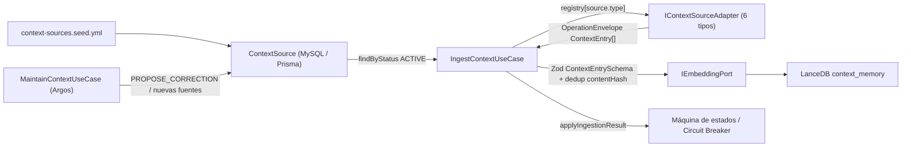
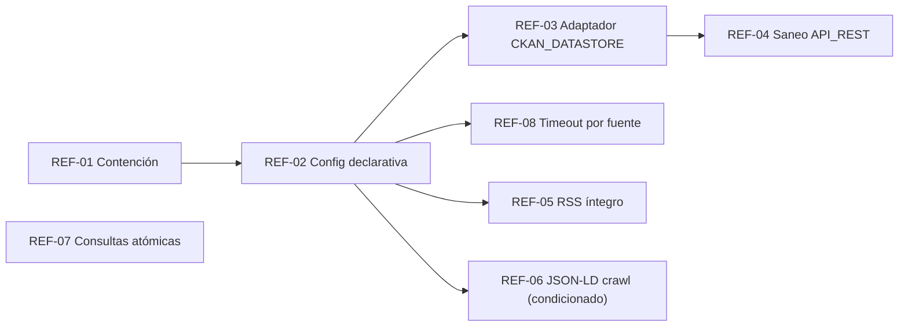

# [ESTUDIO] Contexto Vigente de Fuentes Locales y Refactorizaciones de Minería de Contenedores (S+ Grade)

**Identificador:** ESTUDIO-CTX-002  
**Precedente:** [ESTUDIO-CTX-001 — Viabilidad de Fuentes de Contexto Hiperlocal](./%5BESTUDIO%5D%20Viabilidad%20de%20Fuentes%20de%20Contexto%20Hiperlocal.md)  
**Historia de Usuario Relacionada:** HU 18 — Motor de Contexto Autónomo, RAG Dinámico y Autogestión de Fuentes  
**Fecha de Ejecución:** 2026-10-12  
**Autor:** Antigravity (Protocolo de Acero)  
**Naturaleza:** Documental / Diagnóstico. **No modifica código.** Las refactorizaciones se declaran como backlog (§7) a transformar en PBIs.

---

## 1. Propósito y Alcance

1. Plasmar el **estado real** (código + datos) del subsistema de fuentes de contexto a fecha 2026-10-12, contrastándolo con el estudio fundacional ESTUDIO-CTX-001 (2026-10-02).
2. Diagnosticar la casuística de **ítems contenedor**: entradas persistidas en `context_memory` que no representan una unidad de contexto (evento, lugar, noticia) sino un **envoltorio** que referencia el contenido real. Caso testigo: fuente `bcn-opendata-ckan` (ej. ítem `537cf9607c7c7f6207537b5668b4078d9d5a79ddbca615ac88a2b76b94922d77…`, identificador SHA-256 de 64 hex correspondiente a un `contentHash` de entrada derivada de un *dataset* CKAN).
3. Extender el análisis al resto de fuentes para detectar casuísticas similares (contenedor, agregador, contenido truncado).
4. Declarar las **refactorizaciones pendientes** necesarias para que el contenido de los contenedores aflore como ítems atómicos.

---

## 2. Topología Vigente del Motor de Fuentes

Toda la lógica reside en el *vertical slice* [`src/features/context-sources/`](file:///home/racso/Proyectos/BarcelonaXplorer/src/features/context-sources) (Axioma I).



| Pieza | Archivo | Observación |
|---|---|---|
| Catálogo semilla | [`context-sources.seed.yml`](file:///home/racso/Proyectos/BarcelonaXplorer/src/features/context-sources/context-sources.seed.yml) | 6 fuentes `ACTIVE`, `proposedBy: SEED`. Sin bloque de configuración de extracción. |
| Modelo relacional | [`schema.prisma` · `ContextSource`](file:///home/racso/Proyectos/BarcelonaXplorer/src/prisma/schema.prisma#L251-L279) | Solo `endpoint` + `type` + `category`. **No existe campo para parámetros de extracción** (resource, mapeo de campos, paginación). |
| Contrato de frontera | [`context-entry.schema.ts`](file:///home/racso/Proyectos/BarcelonaXplorer/src/features/context-sources/context-entry.schema.ts) | `ContextEntrySchema` (Zod). `summary` es el texto vectorizado (10–1200 car.). |
| Puerto de adaptador | [`context-source-adapter.port.ts`](file:///home/racso/Proyectos/BarcelonaXplorer/src/features/context-sources/context-source-adapter.port.ts) | 1 adaptador por `ContextSourceType`; un único `fetch()` de una sola fase. |
| Pipeline | [`ingest-context.use-case.ts`](file:///home/racso/Proyectos/BarcelonaXplorer/src/features/context-sources/ingest-context.use-case.ts) | Máx. 20 entradas nuevas/fuente/ciclo; purga por `expiresAt`. |

> [!IMPORTANT]
> El contrato actual asume **una petición HTTP → N ítems atómicos**. No contempla fuentes jerárquicas (catálogo → dataset → recurso → registro) ni páginas índice que enlazan a páginas de detalle. Esta es la causa estructural de la casuística contenedor.

---

## 3. Inventario Vigente de Fuentes (Código Real vs Estudio CTX-001)

| # | `sourceTag` | Tipo / Adaptador | Categoría declarada | Granularidad real del ítem | Prefijo `id` | TTL | Salud semántica |
|---|---|---|---|---|---|---|---|
| A2 | `gencat-agenda-cultural` | `SOCRATA` / [`socrata-context.adapter.ts`](file:///home/racso/Proyectos/BarcelonaXplorer/src/features/context-sources/adapters/socrata-context.adapter.ts) | EVENT | **Atómica** (1 fila = 1 actividad) | `gencat-agenda:` | `data_fi + 1d` | 🟢 Correcta (mejorable: orden/filtro temporal) |
| A3 | `gencat-equipaments-culturals` | `SOCRATA` / mismo adaptador | VENUE | **Atómica** (1 fila = 1 equipamiento) | `gencat-equip:` | 90 d | 🟢 Correcta |
| A11 | `wikidata-barcelona-monuments` | `SPARQL` / [`sparql-context.adapter.ts`](file:///home/racso/Proyectos/BarcelonaXplorer/src/features/context-sources/adapters/sparql-context.adapter.ts) | POI | **Atómica** (1 binding = 1 monumento) | `wikidata:` | 90 d | 🟡 `?description` nunca se enlaza en la consulta → *summary* siempre sintético |
| A10 | `beteve-agenda-cultural` | `RSS` / [`rss-context.adapter.ts`](file:///home/racso/Proyectos/BarcelonaXplorer/src/features/context-sources/adapters/rss-context.adapter.ts) | NEWS | **Atómica con contenido truncado**; ocasionalmente **agregador** | `beteve:` | `pubDate + 7d` | 🟡 Ignora `content:encoded`; feed generalista (no solo cultura) |
| A9 | `bcn-festes-laborals` | `ICAL` / [`ical-context.adapter.ts`](file:///home/racso/Proyectos/BarcelonaXplorer/src/features/context-sources/adapters/ical-context.adapter.ts) | EVENT | **Atómica** (1 VEVENT = 1 festivo) | `bcn-festes:` | `DTEND + 1d` | 🟢 Correcta (precio `Gratis` impuesto semánticamente dudoso) |
| A1 | `bcn-opendata-ckan` | `API_REST` / [`api-rest-context.adapter.ts`](file:///home/racso/Proyectos/BarcelonaXplorer/src/features/context-sources/adapters/api-rest-context.adapter.ts) | EVENT | 🔴 **Contenedor** (1 ítem = 1 *dataset* CKAN con N recursos CSV) | `bcn-opendata:` (fijo) | 30 d (fijo) | 🔴 **Polución semántica** |
| A8 | — (sin semilla) | `JSON_LD` / [`json-ld.adapter.ts`](file:///home/racso/Proyectos/BarcelonaXplorer/src/features/context-sources/adapters/json-ld.adapter.ts) | — | **Contenedor de navegación** (página índice → páginas detalle) | `${sourceTag}:` | evento +1d / 90 d | ⚪ Adaptador disponible, sin fuente activa; fixture TimeOut produce **0 ítems** |

**Desviaciones respecto a CTX-001:**
- El veredicto *Viable* de **A1** se basó en código HTTP 200 y "131 datasets", sin verificar que el *contenido* del dataset llegara a convertirse en ítems. Se reclasifica a **Viable condicionado a refactorización (REF-CTX-02/03)**.
- `HTML_LLM` permanece fuera del enum `ContextSourceType` (coherente con CA-8 de CTX-001), aunque el PBI homónimo figure en `PBI/Realizado`.

---

## 4. Taxonomía de Granularidad de Ítems

| Clase | Definición | Señal de detección | Fuentes afectadas |
|---|---|---|---|
| **G0 · Atómica** | El objeto devuelto *es* la unidad de contexto. | Tiene fecha/coordenadas/nombre propios del evento/lugar. | A2, A3, A9, A11 |
| **G1 · Atómica truncada** | Es la unidad, pero el texto útil está recortado y el completo viaja en otro campo o URL. | `summary` termina en `[…]`; existe `content:encoded` o URL de detalle. | A10 |
| **G2 · Contenedor de datos** | El objeto es **metadato** de un conjunto; los ítems reales viven en recursos hijos. | Campos `resources[]`, `num_resources`, `datastore_active`, `format: CSV/JSON`. | **A1** |
| **G3 · Contenedor de navegación** | Página índice/listado cuyos ítems reales están en páginas enlazadas. | JSON-LD `WebPage`/`CollectionPage`/`ItemList` sin `Event`; enlaces repetitivos a detalle. | A8 |
| **G4 · Agregador editorial** | Un artículo enumera varias actividades en prosa ("Plans per al cap de setmana"). | Categorías `agenda`, `què fer`, `cap de setmana`; listas `<li>`/`<h3>` en el cuerpo. | A10 (ocasional) |

---

## 5. Caso Crítico: `bcn-opendata-ckan` (G2 · Contenedor de Datos)

### 5.1 Evidencia Empírica

**Fixture** [`bcn-opendata-ckan.json`](file:///home/racso/Proyectos/BarcelonaXplorer/Documentacion/Fuentes/muestras-contexto/bcn-opendata-ckan.json) (`package_search?q=agenda`, `count: 131`, 3 resultados en muestra):

| Dataset (`name`) | Título (ca) | Recursos | Formato | `datastore_active` |
|---|---|---|---|---|
| `agendes-publiques-comissionats` | Agendes públiques dels comissionats… | 6 | CSV (ca/es por mandato) | ✅ |
| `agenda-publica-alcaldesa` | Agenda pública de l'alcaldessa Ada Colau… | 4 | CSV | ✅ |
| `agendes-publiques-regidors` | Agendes públiques dels regidors… | 10 | CSV | ✅ |

**Sondas en vivo (2026-10-12):**

| Sonda | Resultado |
|---|---|
| `datastore_search?resource_id=7aabfcaf-…&limit=2` (recurso del 1.er dataset) | 200 OK · `total: 1363` registros · campos `Nom_Acte`, `Data_Acte`, `Hora_Inici_Acte`, `Lloc_Acte`, `Nom_Carrec`… (agenda **institucional** de cargos políticos) |
| `package_search?q=activitats culturals agenda` | 4 datasets: **`agenda-cultural`**, **`agenda-diaria`**, **`agenda-activitats-esportives`**, `equipament-associacions` — todos con recurso CSV `datastore_active: true` + recurso JSON |
| `datastore_search?resource_id=3abb2414-…` (`agenda-cultural`, CSV) | 200 OK · campos `register_id`, `name`, `institution_name`, `addresses_*`, `addresses_district_name`, `geo_epgs_4326_lat/lon`, `start_date`, `end_date`, `timetable` (HTML), `values_*`, `secondary_filters_*` |
| Latencia observada del portal CKAN | **27 s – 59 s** por petición (3 intentos > 10 s; uno agotó el *timeout* del cliente) |

### 5.2 Comportamiento Actual del Adaptador

[`ApiRestContextAdapter.fetch`](file:///home/racso/Proyectos/BarcelonaXplorer/src/features/context-sources/adapters/api-rest-context.adapter.ts#L11-L142):
1. Detecta `result.results[]` de `package_search` y **trata cada dataset como un ítem**.
2. `title` ← `title_translated.ca`; `summary` ← `notes_translated` (descripción del *dataset*, no de una actividad).
3. `category` forzada a `'EVENT'`, `id` prefijado con literal `bcn-opendata:`, sin `startsAt`/`endsAt`, sin coordenadas, TTL fijo 30 días.
4. Ignora `resources[]` y, por tanto, **los 1.363+ registros reales** de cada recurso.

### 5.3 Impacto

| Dimensión | Efecto |
|---|---|
| Semántica RAG | `context_memory` contiene "eventos" que son fichas de catálogo (ej. *"Agendes públiques dels regidors…"*). El generador táctico puede recuperarlas como si fueran actividades. |
| Temática | La consulta `q=agenda` captura **agendas políticas**, no la agenda cultural/ocio objetivo de BarcelonaXplorer. |
| Temporalidad | Sin `startsAt`/`endsAt`, la purga por caducidad no refleja vigencia real (TTL ciego de 30 d). |
| Cobertura | Se desaprovecha la fuente municipal más rica (agenda cultural, diaria y deportiva del Ajuntament, georreferenciada por distrito). |
| Operación | Con *timeout* de 10 s y latencias de 27–59 s, la fuente es candidata recurrente a `DEGRADED` por el Circuit Breaker. |

### 5.4 Causa Raíz

1. **Contrato monofase**: `IContextSourceAdapter.fetch()` no admite resolución jerárquica (dataset → recurso → registros).
2. **Ausencia de configuración de extracción declarativa** en `ContextSource` / seed (Axioma III): no hay dónde declarar `resource_id`, mapeo de campos, filtros ni paginación.
3. **Adaptador `API_REST` acoplado a CKAN** pero con semántica genérica (prefijo y categoría hardcodeados), sin esquema Zod de frontera para la respuesta CKAN (casts `as Record<string, unknown>`; contrario al espíritu *Parse, don't validate* del Axioma II).
4. **Endpoint semilla mal dirigido** (`q=agenda` en lugar de datasets concretos).

> [!NOTE]
> El propio catálogo ya contiene la solución en miniatura: la fuente **A9** (`bcn-festes-laborals`) es un **recurso CKAN** (`/dataset/{id}/resource/{rid}/download`) resuelto manualmente a su URL de descarga. La refactorización propuesta generaliza ese patrón de forma declarativa.

---

## 6. Análisis del Resto de Fuentes (Casuísticas Similares)

### 6.1 A10 · Betevé RSS — G1 (truncado) + G4 (agregador ocasional)
- **Evidencia**: [`beteve-agenda.rss`](file:///home/racso/Proyectos/BarcelonaXplorer/Documentacion/Fuentes/muestras-contexto/beteve-agenda.rss). `<description>` es un extracto que acaba en `[…]`; el artículo íntegro viaja en `<content:encoded>` (namespace declarado), **no consumido** por el adaptador.
- `<guid>` llega vacío; el adaptador cae correctamente a `link` como identificador.
- El feed `/feed/` es **generalista** (ej. ítem de muestra: accidentes de tráfico, categoría `mobilitat`), aunque la fuente se llama "Agenda Cultural". Contamina la categoría NEWS con contenido no turístico.
- **Casuística contenedor**: los artículos de tipo "agenda/plans del cap de setmana" enumeran varias actividades → G4. Su descomposición en ítems requeriría extracción estructurada del HTML del cuerpo; **no se recomienda** con LLM (Filtro C) salvo que el artículo publique JSON-LD `Event`.

### 6.2 A8 · JSON-LD (TimeOut) — G3 (contenedor de navegación)
- **Evidencia**: [`timeout-jsonld.html`](file:///home/racso/Proyectos/BarcelonaXplorer/Documentacion/Fuentes/muestras-contexto/timeout-jsonld.html) contiene un único bloque JSON-LD de `@type: WebPage`. El adaptador filtra por `Event`/`Place` → **0 ítems**.
- Los eventos reales están en las páginas de detalle enlazadas desde el listado. Mismo patrón que CKAN: un **nivel de indirección** no soportado.
- Condicionado legalmente (Directiva UE 2019/790, reserva TDM) — cualquier *crawl* de segundo nivel exige validación previa.

### 6.3 A2/A3 · Socrata Gencat — G0 (sin contenedor), deuda menor
- Atómicas. Sin embargo, el endpoint usa `$limit=25` **sin `$order` ni `$where` temporal**, por lo que puede devolver actividades ya finalizadas (descartadas luego por caducidad) en lugar de las próximas.
- **Contenedor latente**: si en el futuro se usara la *Discovery API* de Socrata (catálogo de datasets) se reproduciría exactamente el caso G2 de CKAN. La estrategia de §7 debe ser agnóstica al portal.

### 6.4 A11 · Wikidata SPARQL — G0, defecto de consulta
- La consulta por defecto proyecta `?description` pero no lo enlaza en el patrón (`schema:description` ausente) → *summary* siempre sintético (`"{título} - Lloc d'interès i monument a Barcelona."`), lo que degrada la calidad del vector.
- Tags constantes (`monument`, `patrimoni`, `poi`).

### 6.5 A9 · iCal Festes — G0, deuda semántica menor
- Atómica y correcta. `price: 'Gratis'` y tags fijos se imponen a días festivos (no son actividades con entrada). Bajo impacto.

### 6.6 Matriz Resumen de Casuísticas

| Fuente | G1 Truncado | G2 Contenedor datos | G3 Contenedor navegación | G4 Agregador | Deuda adicional |
|---|---|---|---|---|---|
| A1 CKAN | — | 🔴 **Sí** | — | — | Temática errónea, timeout, sin Zod |
| A10 Betevé | 🟡 Sí | — | — | 🟡 Ocasional | Feed generalista |
| A8 JSON-LD | — | — | 🟡 Sí (sin semilla) | — | Riesgo legal |
| A2/A3 Socrata | — | ⚪ Latente | — | — | Sin orden/filtro temporal |
| A11 SPARQL | — | — | — | — | `?description` sin enlazar |
| A9 iCal | — | — | — | — | Precio impuesto |

---

## 7. Refactorizaciones Pendientes (Backlog Propuesto)

Cada ítem está acotado para cumplir el umbral de **≤ 3 archivos adyacentes** (Axioma I) y debe cruzar la Santa Trinidad de Oráculos (`tsc --noEmit`, `eslint`, `vitest run`) — Axioma IV.

### REF-CTX-01 · Contención inmediata de `bcn-opendata-ckan` (P1)
- **Acción**: transición `DEACTIVATE` de `bcn-opendata-ckan` (vía Admin Context o seed) y purga en `context_memory` de los documentos con prefijo `bcn-opendata:` (precedente: PBI "Saneamiento Operativo del Corpus Vectorial y Sonda de Pureza").
- **CA**: 0 documentos `bcn-opendata:*` en `context_memory`; fuente en `INACTIVE` con trazabilidad en telemetría.
- **Archivos**: `context-sources.seed.yml` (status), script/sonda de purga existente.

### REF-CTX-02 · Configuración de extracción declarativa por fuente (P1)
- **Acción**: introducir un bloque `extraction` opcional en el seed YAML y su persistencia (`extractionConfig Json?` en `ContextSource`), validado en frontera con una **unión discriminada Zod** por `strategy` (Axioma II + III; API Zod 4 según TC-ZOD-001). El repositorio Prisma la convierte a Value Object sin filtrar tipos generados (TC-PRISMA-001).
- **Borrador de esquema YAML** (ilustrativo, no normativo):

```yaml
# Axioma III: extracción declarativa, sin bifurcaciones imperativas por fuente
- sourceTag: "bcn-agenda-cultural"
  displayName: "Ajuntament de Barcelona - Agenda Cultural"
  endpoint: "https://opendata-ajuntament.barcelona.cat/data/api/3/action"
  type: "CKAN_DATASTORE"
  category: "EVENT"
  status: "PENDING_APPROVAL"
  proposedBy: "HUMAN"
  supersedesSourceTag: "bcn-opendata-ckan"
  extraction:
    strategy: "CKAN_DATASTORE"
    dataset: "agenda-cultural"            # package_show?id=
    resourceSelector:                     # resolución dataset → recurso
      format: "CSV"
      datastoreActive: true
    groupBy: "register_id"                # formato largo: N filas por actividad (a verificar)
    window:                               # filtro temporal en servidor
      endField: "end_date"
      fromNow: true
    pageSize: 100
    maxRecords: 500
    timeoutMs: 60000                      # latencia observada 27–59 s
    fieldMap:
      externalId: "register_id"
      title: "name"
      summary: ["name", "institution_name", "addresses_neighborhood_name", "timetable"]
      startsAt: "start_date"
      endsAt: "end_date"
      locationName: "institution_name"
      lat: "geo_epgs_4326_lat"
      lng: "geo_epgs_4326_lon"
      tags: ["addresses_district_name", "secondary_filters_name"]
```

- **CA**: seed actual sigue cargando sin `extraction` (retrocompatible); `extraction` inválido → fuente rechazada con `OperationEnvelope` de error 422.
- **Archivos**: `context-source.types.ts`, `context-source-seed.service.ts`, `schema.prisma` (+ `prisma-context-source.repository.ts` como adaptador de persistencia).

### REF-CTX-03 · Adaptador `CKAN_DATASTORE` con resolución bifásica (P1)
- **Acción**: nuevo valor `CKAN_DATASTORE` en `ContextSourceTypeSchema` y en el enum Prisma; nuevo adaptador colocalizado `adapters/ckan-datastore-context.adapter.ts` (+ `.test.ts`):
  1. **Fase Resolve**: `package_show?id={dataset}` → selección determinista del recurso según `resourceSelector` (Zod sobre la respuesta CKAN).
  2. **Fase Extract**: `datastore_search?resource_id=…&limit=…&offset=…` (o `datastore_search_sql` con filtro `end_date >= now()`), paginando con `_links.next` hasta `maxRecords`.
  3. **Fase Map**: agregación por `groupBy` (si formato largo), mapeo declarativo vía `fieldMap`, limpieza HTML de `timetable`, validación con `ContextEntrySchema`.
- **Reglas**: `id = ${sourceTag}:${externalId}`, `category` desde `source.category`, `expiresAt = endsAt + 1d` o TTL por categoría; sin LLM (Filtro C).
- **Fuentes a dar de alta** (todas `PENDING_APPROVAL`, aprobación humana): `agenda-cultural` (EVENT), `agenda-diaria` (EVENT), `agenda-activitats-esportives` (EVENT), y los candidatos E1 `mercats` (VENUE) / E2 `espais-verds` (POI) de CTX-001 tras identificar su dataset concreto.
- **CA**: fixtures nuevos `muestras-contexto/ckan-package-show-agenda-cultural.json` y `ckan-datastore-agenda-cultural.json`; test que verifica ≥ 1 ítem con `startsAt`, coordenadas dentro de la caja BCN y `id` no repetido tras `groupBy`.

### REF-CTX-04 · Saneamiento del adaptador `API_REST` genérico (P2)
- **Acción**: retirar la heurística CKAN del adaptador genérico (queda cubierta por REF-CTX-03); prefijo `id` desde `source.sourceTag`; `category` desde `source.category`; esquema Zod de frontera en lugar de casts.
- **CA**: el test actual se reescribe para un JSON REST plano; ningún literal `bcn-opendata` en el adaptador.

### REF-CTX-05 · RSS: contenido íntegro y filtrado temático (P2)
- **Acción**: usar `<content:encoded>` (despojado de HTML) como fuente preferente de `summary` (recortado a 1200); cambiar endpoint semilla a un feed de sección cultural/agenda de Betevé si existe (verificación empírica previa) o filtrar por `<category>` mediante lista blanca declarada en `extraction`.
- **G4 (agregadores)**: solo marcar con tag `agregador` para trazabilidad; descomposición diferida hasta disponer de evidencia de JSON-LD `Event` en artículos.
- **Archivos**: `rss-context.adapter.ts`, `.test.ts`, seed.

### REF-CTX-06 · JSON-LD: descenso listado → detalle (P3, condicionado)
- **Acción**: estrategia `extraction.strategy: "JSONLD_CRAWL"` con `detailLinkSelector`, `sameOriginOnly: true`, `maxDetails` y respeto de `robots.txt` (reutilizando la sonda determinista de Argos).
- **Precondición**: veredicto legal explícito del Vértice Biológico sobre la reserva TDM de la fuente objetivo.

### REF-CTX-07 · Correcciones de consulta en fuentes atómicas (P3)
- **SPARQL**: añadir `OPTIONAL { ?item schema:description ?description FILTER(LANG(?description) IN ("ca","es","en")) }`.
- **Socrata Agenda**: añadir `$order=data_inici ASC` y `$where=data_fi >= '{hoy}'` (plantilla de fecha resuelta en el adaptador).
- **iCal**: no imponer `price` ni tags fijos; derivar tags de `DESCRIPTION` (ej. *Festes estatals* / *locals*).

### REF-CTX-08 · Timeout por fuente y actualización documental (P2)
- **Acción**: `timeoutMs` configurable vía `extraction` (por defecto 10 s); actualizar en CTX-001 el veredicto de A1 a *Viable condicionado (ver ESTUDIO-CTX-002)* y registrar los nuevos fixtures.

### Orden de Ejecución Recomendado



---

## 8. Riesgos y Puntos Abiertos

| # | Riesgo / Incógnita | Mitigación |
|---|---|---|
| 1 | El dataset `agenda-cultural` parece publicarse en **formato largo** (columnas `values_*`): varias filas por `register_id`. | Verificar con muestra ≥ 100 registros antes de fijar `groupBy`; test de unicidad de `id`. |
| 2 | Latencia CKAN 27–59 s → `DEGRADED` recurrente. | `timeoutMs` por fuente (REF-08) y paginación acotada (`maxRecords`). |
| 3 | Cambio de `resource_id` cuando el Ajuntament republica el CSV. | Resolver siempre por `dataset` + `resourceSelector` (fase Resolve), nunca fijar `resource_id` en semilla. |
| 4 | Volumen: cientos de actividades vs límite de 20 nuevas/fuente/ciclo. | Mantener el límite térmico; priorizar por `start_date` ascendente. |
| 5 | Ampliar el enum `ContextSourceType` exige migración Prisma y revisión del Panel Admin Context. | Incluir en el PBI derivado de REF-03 la actualización de la UI de gobernanza. |

---

## 9. Referencias

- [ESTUDIO-CTX-001 · Viabilidad de Fuentes de Contexto Hiperlocal](./%5BESTUDIO%5D%20Viabilidad%20de%20Fuentes%20de%20Contexto%20Hiperlocal.md)
- [Axiomas de Forja S+ Grade](file:///home/racso/Proyectos/BarcelonaXplorer/.SddIA/library/norms/%5BARQUITECTURA%5D%20Anexo%20Constitucional:%20Axiomas%20de%20Forja%20S+%20Grade%20%28Optimizaci%C3%B3n%20para%20IA%29.md)
- [Estándar de Formato de Configuración YAML](file:///home/racso/Proyectos/BarcelonaXplorer/.SddIA/library/norms/Estandar-Formato-Configuracion.yml)
- [Códice Tecnológico Next.js + Prisma](file:///home/racso/Proyectos/BarcelonaXplorer/.SddIA/library/codexes/tech-master-nextjs-prisma.md) (TC-PRISMA-001, TC-ZOD-001, TC-TEST-001)
- API CKAN: `package_search`, `package_show`, `datastore_search`, `datastore_search_sql` — `https://opendata-ajuntament.barcelona.cat/data/api/3/action/`
