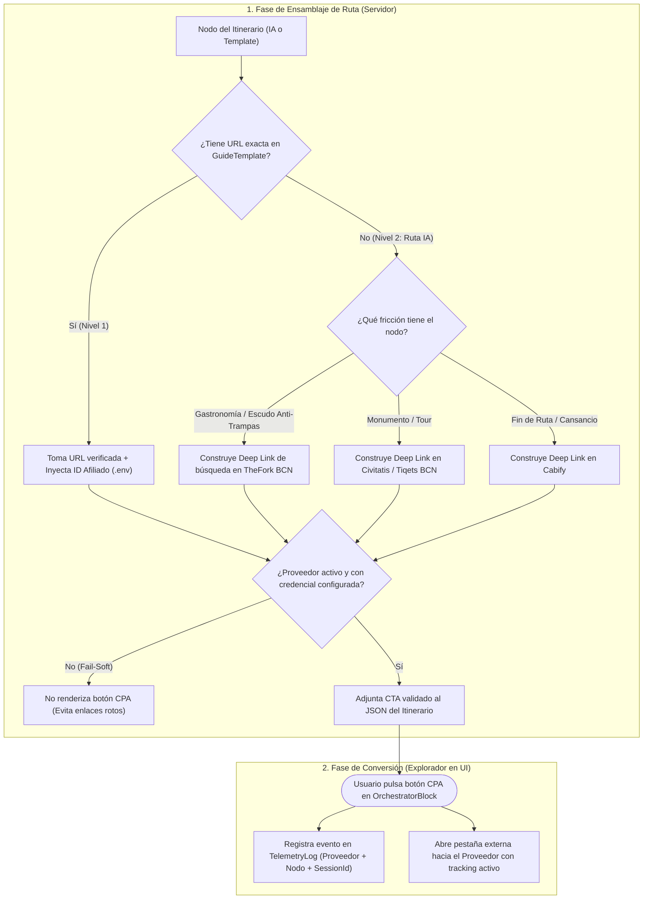

### [ARQUITECTURA] Historia de Usuario: Ecosistema de Afiliación Asimétrica (Vía del Fuego), Catálogo de Proveedores CPA/CPS y Telemetría de Conversión
**Identificador:** HU-20
**Estatus:** Refinado / Listo para Desglose en PBIs
**Fecha de Emisión:** 2026-10-14
**Autor:** Vértice Biológico (Racso) & Tormentosa (Protocolo de Acero S+ Grade)[cite: 19]
**Referencias Normativas:** `CONSTITUTION.md` · `ADR-001 (Vertical Slicing)` · `Base Fundacional BX v1.0 (Vía del Fuego)`[cite: 19, 23, 32]

--------------------------------------------------------------------------------

#### Matriz de Indexación Tridimensional
* **Naturaleza:** Especificación Funcional de Negocio, Ingeniería de Ingresos Pasivos (CPA/CPS), Resolución Determinista de Enlaces de Afiliación y Trazabilidad de Conversión[cite: 19, 23, 27].
* **Entorno:** Ecosistema `BarcelonaXplorer` (Monolito Next.js App Router + Persistencia Relacional `MySQL/Prisma` + Telemetría Centralizada en Nodo 11)[cite: 19, 30].
* **Entropía Asimilada:** Destilado de la fricción simbiótica directa[cite: 10]. Evolución desde la referencia primitiva y estática a `TheFork` en el código actual hacia un subsistema completo de monetización desatendida que gestiona múltiples proveedores en los tres vectores de fricción logística (Gastronomía, Cultura/Ocio y Movilidad) sin permitir que el LLM alucine URLs[cite: 5, 23, 27].

--------------------------------------------------------------------------------

#### 1. Descripción General
**Como** Vértice Biológico / Operador de Negocio de BarcelonaXplorer[cite: 19],
**Quiero** disponer de un sistema centralizado y declarativo para dar de alta proveedores de afiliación (Gastronomía, Cultura/FreeTours y Movilidad), inyectar sus enlaces de forma contextualizada en los puntos de fricción de los itinerarios (tanto generados por IA como procedentes de rutas predefinidas) y registrar cada clic de salida en el motor de telemetría[cite: 19, 22, 23, 27],
**Para** activar la **Vía del Fuego** (monetización pasiva CPA/CPS de forma desatendida y sin parecer publicidad intrusiva), garantizando que todos los enlaces lleven correctamente mis credenciales de afiliado reales y que ningún enlace roto o alucinado por la IA arruine la conversión del usuario[cite: 5, 23, 27].

--------------------------------------------------------------------------------

#### 2. Tareas Previas del Vértice Biológico (Operativa Externa y Alta en Proveedores)

Antes de que el sistema pueda firmar enlaces reales en producción (Nodo 11), el Vértice Biológico debe completar el aprovisionamiento de cuentas externas[cite: 5, 19]. Para minimizar la fricción administrativa y no depender de aprobaciones individuales lentas, se establece una estrategia dual (Agregadores + Alta Directa):

##### 2.1. Mapa de Proveedores, Portales de Alta y Estrategia de Acceso

| Vector de Fricción | Proveedor Objetivo | Estrategia Recomendada | URL del Portal de Afiliados / Registro | Identificador a Obtener (`Env Var`) |
| :--- | :--- | :--- | :--- | :--- |
| **Agregador Global (Recomendado Paso 1)** | **Travelpayouts** *(Agrupa Tiqets, GetYourGuide, Booking, etc.)* | Alta única inmediata sin requisito de tráfico mínimo inicial. | `[https://www.travelpayouts.com/](https://www.travelpayouts.com/)` | `TRAVELPAYOUTS_MARKER_ID` |
| **Agregador Alternativo (Europa/España)** | **Awin** *(Red oficial donde opera TheFork en España)* | Registro como Publisher para conectar con programas gastronómicos y de movilidad. | `[https://www.awin.com/es/afiliados](https://www.awin.com/es/afiliados)` | `AWIN_PUBLISHER_ID` |
| **1. Cultura, Visitas y FreeTours**[cite: 23, 27] | **Civitatis** *(Prioritario para "Barcelona de libro" y FreeTours)* | Alta directa muy ágil para proyectos en español; excelente conversión en FreeTours. | `[https://www.civitatis.com/es/afiliados/](https://www.civitatis.com/es/afiliados/)` | `AFFILIATE_CIVITATIS_ID` |
| **1. Cultura y Monumentos (Colas)**[cite: 23, 27] | **Tiqets** *(Sagrada Familia, Park Güell, Casa Batlló)* | Vía Travelpayouts o portal directo de afiliados de Tiqets. | `[https://www.tiqets.com/en/affiliate-program/](https://www.tiqets.com/en/affiliate-program/)` | `AFFILIATE_TIQETS_ID` |
| **1. Cultura y Experiencias**[cite: 23, 27] | **GetYourGuide** | Vía Travelpayouts o portal directo de partners. | `[https://partner.getyourguide.com/](https://partner.getyourguide.com/)` | `AFFILIATE_GYG_PARTNER_ID` |
| **2. Gastronomía (Reservas)**[cite: 23, 27] | **TheFork (ElTenedor)** | Vía red **Awin** (Programa TheFork ES) o programa de partners. | `[https://www.theforkmanager.com/](https://www.theforkmanager.com/)` / Vía Awin | `AFFILIATE_THEFORK_ID` |
| **3. Movilidad (Fatiga / Lluvia)**[cite: 22, 23, 27] | **Cabify / FreeNow** | Alta en programa de referidos/afiliados B2B o enlaces profundos (Deep Links) a la App. | `[https://cabify.com/es](https://cabify.com/es)` / `[https://www.free-now.com/es/](https://www.free-now.com/es/)` | `AFFILIATE_CABIFY_CODE` |

##### 2.2. Checklist de Tareas Manuales para Racso (Vértice Biológico)
1. **[Tarea VB-01] Identidad Pública Mínima:** Asegurar que el dominio público de `BarcelonaXplorer` responde con la landing operativa, ya que Civitatis y Awin revisan que la URL declarada exista.
2. **[Tarea VB-02] Alta en Civitatis y Travelpayouts (Quick Wins):** Registrarse primero en `Civitatis Afiliados` y `Travelpayouts`. Son los más rápidos en aprobar y desbloquean de inmediato la monetización de monumentos y de las rutas literarias (*"Barcelona de libro"*).
3. **[Tarea VB-03] Alta en Awin para TheFork:** Solicitar ingreso en el programa de `TheFork España` dentro de Awin para obtener el formato de enlace de seguimiento (`[awin1.com/cread.php](https://awin1.com/cread.php)...` o parámetro de afiliado directo).
4. **[Tarea VB-04] Custodia de Credenciales:** Anotar los identificadores obtenidos e inyectarlos en el fichero `.env.local` (y en la sincronización de Ansible hacia `shared/.env.local` en el Nodo 11)[cite: 28, 31].

--------------------------------------------------------------------------------

#### 3. Funcionamiento del Subsistema en BarcelonaXplorer (Alcance Funcional)

Una vez que disponemos de los proveedores, el sistema en `BarcelonaXplorer` debe abandonar el ejemplo estático actual de `TheFork` y operar bajo **cuatro pilares funcionales**:

##### 3.1. Catálogo Declarativo de Proveedores de Afiliación
El sistema contará con una configuración estructurada donde se definen los proveedores activos (`THEFORK`, `CIVITATIS`, `TIQETS`, `GETYOURGUIDE`, `CABIFY`)[cite: 23, 27], asociando cada uno a:
* Su **Categoría de Fricción**: `GASTRONOMY` (Incertidumbre/Trampas), `CULTURE_TICKETS` (Espera/Colas/Tours), `MOBILITY` (Cansancio/Clima)[cite: 22, 23, 27].
* Su **Estado Operativo**: Activo / Inactivo (si un proveedor aún no tiene cuenta aprobada o falta su variable de entorno, el sistema lo oculta limpiamente sin mostrar botones rotos — *Fail-Soft*)[cite: 19].
* Su **Plantilla de Construcción de Enlace (URL Pattern)**: Cómo se inyecta el ID de afiliado y cómo se construye una búsqueda parametrizada en Barcelona cuando no hay una URL específica pre-curada.

##### 3.2. Prohibición de Alucinación de Enlaces por el LLM (Resolución en Dos Niveles)
Para cumplir el **Filtro A (Ausencia de Alucinación)**, el motor generativo (`Gemini / System Two`) **jamás inventará ni escribirá URLs de afiliados**[cite: 5, 19]. El LLM solo indicará en cada parada del itinerario qué tipo de necesidad logística existe (ej. *"Parada gastronómica en El Born"* o *"Monumento con alta cola de espera"*)[cite: 27].

Un servicio interno de `BarcelonaXplorer` resolverá el enlace aplicando esta jerarquía estricta:
1. **Nivel 1 — Enlace Curado Exacto (Prioridad Máxima):** Si el nodo proviene de un `GuideTemplate` en MySQL (ej. el *FreeTour de La Sombra del Viento* en Civitatis o una entrada específica a Santa María del Mar)[cite: 19, 22], se utiliza la URL exacta verificada en la plantilla y se le anexa automáticamente el ID de afiliado del entorno.
2. **Nivel 2 — Enlace Profundo de Búsqueda Contextual (Fallback Inteligente):** Si el nodo ha sido generado dinámicamente por la IA (ej. recomendación de comer cerca de una parada en el barrio de Gràcia), el sistema genera un enlace válido hacia el buscador del proveedor pre-filtrado por el nombre del lugar o el barrio en Barcelona (ej. búsqueda en `TheFork` o `Civitatis Barcelona`) firmado con nuestro ID de afiliado.

##### 3.3. Reglas de Inyección Asimétrica en la Ruta (Táctica del Refugio)
Los botones de afiliación no se muestran en todas las paradas por igual para no saturar al usuario, sino que obedecen a las reglas de negocio de la **Táctica del Refugio**[cite: 22, 27]:
* **Inyección Gastronómica (`TheFork`):** Se activa en los nodos de almuerzo/cena y de forma obligatoria inmediatamente debajo de las alertas del **Escudo Anti-Trampas** (*"Evita los locales trampa de esta avenida; asegura mesa en opciones verificadas de la zona"*)[cite: 22, 23, 27].
* **Inyección Cultural (`Civitatis` / `Tiqets` / `GetYourGuide`):** Se activa en nodos de monumentos con alerta de colas y como botón principal de acción en las rutas predefinidas de modalidad `BOOKABLE_TOUR` (FreeTours)[cite: 22, 23, 27].
* **Inyección de Movilidad (`Cabify` / `FreeNow`):** Se activa al final de itinerarios con alta carga peatonal acumulada o cuando el contexto climático indique lluvia[cite: 22, 23, 27].

##### 3.4. Pasarela de Redirección y Telemetría de Conversión
Para no operar a ciegas, el usuario no saldrá directamente al proveedor sin dejar rastro estadístico:
* Cada clic en un botón de afiliado será registrado en el subsistema de `telemetry` (`TelemetryLog` en MySQL) asociando: el `bx_session_id` (Identidad Sombra), el proveedor (`THEFORK`, `CIVITATIS`, etc.), el identificador de la ruta o plantilla origen y el nodo donde se produjo la conversión[cite: 19, 20, 22].
* Esto permitirá visualizar en el panel `/Admin/Logs` qué rutas y qué proveedores están generando tráfico monetizable real[cite: 19, 20].

--------------------------------------------------------------------------------

#### 4. Coreografía Funcional del Flujo de Monetización

--------------------------------------------------------------------------------

#### 5. Normativas Arquitectónicas (Certificación Yunque S+)
1. **Cero Credenciales Hardcodeadas:** Todos los identificadores de afiliado (`partner_id`, `marker`, `publisher_id`) deben leerse exclusivamente desde variables de entorno, respetando las lecciones aprendidas en las auditorías de seguridad del proyecto (`AUD-OPS-STEEL-001`)[cite: 19].
2. **Degradación Elegante (`Fail-Soft`):** Si aún no hemos completado el alta en uno de los proveedores (ej. tenemos `Civitatis` activo pero aún no `Tiqets`), el sistema simplemente omitirá o sustituirá ese proveedor sin lanzar errores ni romper la generación de la ruta[cite: 19].
3. **Cuarteto de Oráculos Obligatorio:** Todo desarrollo derivado deberá superar `tsc --noEmit`, `eslint --max-warnings 0`, `vitest run` y `npm run build`[cite: 19].

--------------------------------------------------------------------------------

#### 6. Criterios de Aceptación (Verificación Empírica)

##### Escenario 1: Resolución de Enlace Exacto en Ruta Predefinida (Nivel 1)
* **Dado** que el proveedor `CIVITATIS` está activo y tiene su identificador configurado en el entorno.
* **Cuando** se genera un itinerario que incluye una parada o ruta predefinida con URL curada (ej. *"FreeTour de La Sombra del Viento"*).
* **Entonces** el nodo muestra el botón de acción con la URL exacta del tour incluyendo el parámetro de afiliado real de `BarcelonaXplorer`[cite: 19, 22, 23].

##### Escenario 2: Generación Determinista de Enlace de Búsqueda en Ruta de IA (Nivel 2)
* **Dado** un itinerario generado dinámicamente por la IA que incluye una parada gastronómica con advertencia del `Escudo Anti-Trampas` en el barrio de El Born[cite: 22, 27].
* **Cuando** el servicio de afiliación procesa el nodo sin URL predefinida.
* **Entonces** genera de forma determinista (sin intervención del LLM) un enlace válido hacia `TheFork` parametrizado con la zona/restaurante y las credenciales de afiliado activas[cite: 5, 23, 27].

##### Escenario 3: Comportamiento Fail-Soft ante Proveedor No Configurado
* **Dado** que un proveedor del catálogo (ej. `TIQETS`) aún no tiene su clave de afiliado definida en las variables de entorno del servidor.
* **Cuando** el orquestador genera una ruta con monumentos culturales.
* **Entonces** el sistema no muestra botones rotos ni enlaces de ejemplo ficticios para `TIQETS`, priorizando otro proveedor cultural activo (como `CIVITATIS`) o mostrando únicamente la información táctica del nodo[cite: 19, 23].

##### Escenario 4: Registro de Telemetría de Conversión CPA
* **Dado** un itinerario renderizado en pantalla con botones de afiliación activos[cite: 19].
* **Cuando** el usuario hace clic en un botón de reserva (ej. `TheFork` o `Civitatis`)[cite: 23, 27].
* **Entonces** el usuario es dirigido a la plataforma del proveedor en una nueva pestaña y se persiste asíncronamente un registro en `TelemetryLog` indicando el proveedor, el nodo de origen y el `bx_session_id`[cite: 19, 22].

--------------------------------------------------------------------------------

#### 7. Desglose Táctico Propuesto en PBIs (Regla <= 3 Archivos Adyacentes)[cite: 21]
1. **`PBI-AFF-001` (Catálogo de Proveedores y Configuración de Entorno):** Definición de esquemas de proveedores (`THEFORK`, `CIVITATIS`, `TIQETS`, `GETYOURGUIDE`, `CABIFY`), variables de entorno en `.env.example` y servicio de validación de estado (`Fail-Soft`)[cite: 19, 23].
2. **`PBI-AFF-002` (Motor Determinista `AffiliateLinkResolver`):** Implementación de la lógica de resolución en dos niveles (URL exacta de `GuideTemplate` vs. plantilla de búsqueda parametrizada) y sustitución del ejemplo primitivo de `TheFork` en el `planner`[cite: 19, 22].
3. **`PBI-AFF-003` (Telemetría de Clics e Inyección Visual en `OrchestratorBlock`):** Registro de eventos de conversión hacia `TelemetryLog` al pulsar los CTAs y ajuste visual de los botones bajo el `Escudo Anti-Trampas`[cite: 19, 20, 22, 27].
