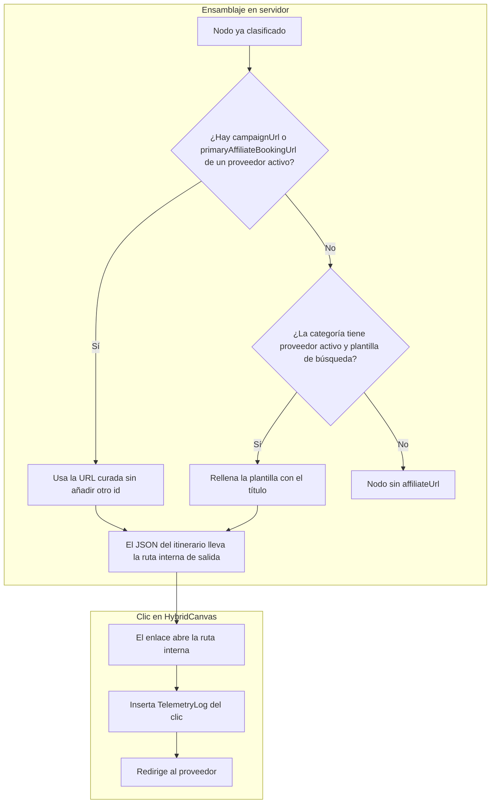

### [ARQUITECTURA] Historia de Usuario: Ecosistema de Afiliación Asimétrica (Vía del Fuego), Catálogo de Proveedores y Telemetría de Salida

**Identificador:** HU-20
**Estatus:** Refinado contra el código vigente / Listo para desglose en PBIs
**Fecha de emisión:** 2026-10-14
**Fecha de refinamiento:** 2026-10-14
**Autor:** Vértice Biológico (Racso)
**Referencias:** [`CONSTITUTION.md`](file:///home/racso/Proyectos/BarcelonaXplorer/CONSTITUTION.md) · [`ADR-001`](file:///home/racso/Proyectos/BarcelonaXplorer/Documentacion/ADR/ADR-001-Topologia-Codigo-Vertical-Slicing-vs-Capas.md) · [Motor híbrido de rutas predefinidas](./%5BARQUITECTURA%5D%20Historia%20de%20Usuario:%20Motor%20H%C3%ADbrido%20de%20Rutas%20Predefinidas%20%28%22Barcelona%20de%20libro%22%29%20e%20Inyecci%C3%B3n%20Contextual%20en%20Orquestador.md) · [`PBI-ORCH-PRO-001`](file:///home/racso/Proyectos/BarcelonaXplorer/Documentacion/PBI/Pendiente/Fricciones_interaccion_PRO_ruta_generada.md) · [`AUD-OPS-STEEL-001`](file:///home/racso/Proyectos/BarcelonaXplorer/Documentacion/Auditorias/Auditoria%20-%20Log%20de%20Friccion%20HU-15%20Hombre%20de%20Acero%20%28Delta%20v2.0.1-doc-anchor%20a%201c4d1b0%29.md)

--------------------------------------------------------------------------------

#### Matriz de indexación

* **Naturaleza:** Firmar enlaces de afiliación con un identificador real, resolverlos fuera del LLM y dejar constancia del clic de salida.
* **Entorno:** Monolito Next.js (App Router) en el Nodo 11, MySQL/Prisma (`TelemetryLog`, `GuideTemplate`, `TemplateItem.affiliateRefs`). El enriquecedor vive en [`src/features/planner/affiliate/`](file:///home/racso/Proyectos/BarcelonaXplorer/src/features/planner/affiliate/). El CTA se pinta en [`hybrid-canvas.tsx`](file:///home/racso/Proyectos/BarcelonaXplorer/src/components/tactical/hybrid-canvas.tsx).
* **Qué cambia respecto del código de hoy:** el enriquecedor ya clasifica paradas y ya escribe una URL. Esa URL lleva el literal `bcn_xplorer`. Esta historia sustituye ese literal por una credencial de entorno, o omite el botón si la credencial no existe.

--------------------------------------------------------------------------------

#### 1. Descripción

**Como** operador de BarcelonaXplorer,  
**Quiero** un catálogo de proveedores cuyas URLs se construyen en servidor a partir de una ficha curada o de una plantilla de búsqueda firmada,  
**Para** que el explorador salga hacia un programa de afiliación real y el clic quede en `TelemetryLog`, sin que el modelo de lenguaje escriba la URL.

--------------------------------------------------------------------------------

#### 2. Hecho vigente (contra lo que se construye)

El LLM de ruta no emite `affiliateUrl`. La URL la escribe `AffiliateEnricherService.enrichWaypoint` después del parseo de la ruta.

Sobre `título + descripción` en minúsculas se hace `includes`. La rama gastronómica va antes que la cultural. La lista gastronómica contiene las subcadenas `bar` y `cafe`. `bar` aparece dentro de `Barcelona` y de `barrio`, así que una parada que solo nombra la ciudad sale `GASTRONOMY` / `THEFORK`. Ese defecto es el corte A de `PBI-ORCH-PRO-001`. Esta historia no lo reimplementa. `PBI-AFF-002` espera a ese corte: si no, la plantilla firmada se pegaría al mismo falso positivo.

Plantillas escritas en el fuente, con el mismo literal en las dos opciones del waypoint:

| Proveedor emitido | Plantilla actual |
| :--- | :--- |
| `THEFORK` | `https://www.thefork.es/search?cityId=415144&query=<título>&tag=bcn_xplorer` |
| `CIVITATIS` | `https://www.civitatis.com/es/barcelona/?query=<título>&aid=bcn_xplorer` |

`cityId=415144`, `tag` y `aid` no leen entorno. `src/.env.example` no declara ninguna variable `AFFILIATE_*`. Ansible copia `src/.env.web` hacia `shared/.env.web` en el Nodo 11 (`ansible/deploy.yml`). El destino `shared/.env.local` no es el de este despliegue.

Dos enums conviven y no coinciden:

| Superficie | Valores |
| :--- | :--- |
| Itinerario enriquecido y `PROVIDER_AFFILIATE_FETCH` | `THEFORK`, `CIVITATIS`, `NONE` |
| `affiliateRefs` de la plantilla | `THE_FORK`, `CIVITATIS`, `TIQETS`, `CABIFY`, `FREE_NOW` |

`GetYourGuide` no está en ninguno. El lienzo tiene ramas de copy para `CABIFY`, `FREENOW` y `TIQETS`, y el enriquecedor no emite esos valores. `EnrichedRoute` no tiene categoría de movilidad: las categorías son `GASTRONOMY`, `CULTURE`, `ACTIVITY`, `TRANSIT` y `GENERAL`.

`enrichRoute(route, thermalState)` solo recibe `operational` o `saturated`. No recibe lluvia. Un CTA de movilidad por clima no tiene entrada en este servicio.

`TemplateItem.affiliateRefs` ya persiste `provider`, `externalId`, `campaignUrl`, `ctaLabel` y `placementTrigger`. El enriquecedor no lee ese JSON. La modalidad `BOOKABLE_TOUR` y la columna `primaryAffiliateBookingUrl` están especificadas en la historia del motor híbrido y todavía no están en el esquema: el tour de *La sombra del viento* que esa historia contrastó es un producto de pago de Civitatis, en borrador hasta confirmar la ficha en castellano. No es un free tour, no sale de Canaletes y no cierra en Santa Maria del Mar.

`STATIC_AFFILIATE_CATALOG` repite el literal `bcn_xplorer` en fichas de El Xampanyet, Cervecería Catalana, Sagrada Família y Casa Batlló. Ningún servicio lo importa. No es un inventario verificado.

El evento `PROVIDER_AFFILIATE_FETCH` se escribe al enriquecer la ruta, con un solo `provider` (el primero distinto de `NONE`), el `sessionId` y el recuento de opciones. Se ve en `/Admin/Logs`. El `<a target="_blank">` del lienzo no llama a telemetría. No hay pasarela de redirección.

El mismo método rellena `priceEstimate` (`25€ - 40€`, `18€ - 30€`) y `rating` (`4.8`, `4.6`) con literales. Esos números no vienen de ningún proveedor.

La patrulla de Telegram ya nombra `CABIFY`, `FREENOW` y `UBER` en sus drops de movilidad. Ese canal no es el CTA del itinerario y esta historia no lo modifica.

--------------------------------------------------------------------------------

#### 3. Tareas del operador (fuera del código)

El alta en una red es una revisión del publisher. Esta historia no fija plazos ni exige tráfico mínimo: eso lo dice el programa el día de la solicitud.

El operador guarda, por cada programa aceptado, **una URL de ejemplo** copiada del panel del proveedor. El código no inventa el formato (`cread.php`, `marker`, `aid`, `tag`). La variable de entorno se nombra en `.env.example` cuando esa URL de ejemplo existe.

| Vector | Programa a solicitar | Dónde se pide | Qué no usar como portal |
| :--- | :--- | :--- | :--- |
| Cultura, prioridad | Civitatis, alta directa | El alta de afiliados que publique Civitatis ese día. La ruta `/es/afiliados/` se comprueba antes de citarla en la solicitud. | Una URL de ficha de producto con `aid=bcn_xplorer`. |
| Gastronomía | TheFork España dentro de Awin, si el programa sigue abierto a publishers | Alta de publisher en Awin y, después, solicitud al programa TheFork ES. | `theforkmanager.com`: es el backoffice de restaurantes. |
| Monumentos | Tiqets, solo si el panel entrega una URL de seguimiento | El portal de afiliados que figure en la propia Tiqets. | Dar por hecho que un agregador ya incluye a Tiqets. |
| Agregador, opcional | Travelpayouts, si el operador prefiere una sola cuenta para programas que el panel liste ese día | `https://www.travelpayouts.com/` | Afirmar que la cuenta agrupa Tiqets, GetYourGuide y Booking, o que la aprobación es inmediata. |
| Movilidad | Cabify o Free Now, solo si existe un programa de publisher con URL de seguimiento | El enlace de alta que entregue ese programa. | `cabify.com/es` y `free-now.com/es`, que son las webs de viajero. |

`GetYourGuide` queda fuera del catálogo de esta historia. Entra en un PBI posterior el día en que haya URL de ejemplo y un valor nuevo en los dos enums.

##### Checklist

1. **VB-01.** El origen público que se va a declarar en las solicitudes responde. Civitatis y Awin piden un sitio; la historia no supone el criterio con el que aprueban.
2. **VB-02.** Solicitar Civitatis. Anotar la URL de ejemplo y el nombre del parámetro de seguimiento.
3. **VB-03.** Solicitar Awin y el programa TheFork ES. El identificador `AFFILIATE_THEFORK_ID` solo se crea si el ejemplo de Awin se rellena con un único token. Si el seguimiento es una URL envuelta completa, la variable guarda esa plantilla, no un id inventado.
4. **VB-04.** Poner las variables en `src/.env.web` (y el equivalente local de desarrollo). El despliegue las lleva a `shared/.env.web`. No se escribe `shared/.env.local`.

Sin VB-02 o VB-03 el código correspondiente sigue en fail-soft: la ruta se genera y el botón de ese proveedor no se pinta.

--------------------------------------------------------------------------------

#### 4. Comportamiento objetivo

##### 4.1. Catálogo

Un módulo del feature `planner/affiliate` declara cada proveedor con:

* clave canónica del itinerario (`THEFORK`, `CIVITATIS`, y `TIQETS` solo cuando VB entregue URL de ejemplo);
* clave de plantilla cuando difiera (`THE_FORK` se mapea a `THEFORK` en la frontera; el JSON ya guardado no se reescribe en esta historia);
* categoría que puede dispararlo (`GASTRONOMY` o `CULTURE`);
* activo solo si la variable de entorno asociada tiene valor;
* plantilla de búsqueda tomada de la URL de ejemplo del operador, con un hueco para el texto de la parada.

`CABIFY` y `FREE_NOW` siguen en el enum de plantilla. No pasan al enum de `EnrichedRoute` en los tres PBI de esta historia.

##### 4.2. Resolución en dos niveles

El modelo sigue sin escribir URLs. El resolutor, en servidor:

1. **Ficha curada.** Si el nodo trae un `affiliateRefs[].campaignUrl` del proveedor activo, o si el tramo es un `BOOKABLE_TOUR` con `primaryAffiliateBookingUrl` ya persistida por la historia del motor híbrido, se usa esa URL tal cual. Si la ficha ya incluye el seguimiento, no se le concatena otro id.
2. **Búsqueda firmada.** Si no hay ficha y la categoría del nodo (ya corregida por el corte A de `PBI-ORCH-PRO-001`) tiene un proveedor activo, se rellena la plantilla de búsqueda con el título de la parada.

Si el proveedor está inactivo, el nodo queda sin `affiliateUrl` y sin botón de ese proveedor. No se sustituye Tiqets por Civitatis, ni se deja el literal `bcn_xplorer`. Otro proveedor solo aparece si ese nodo tiene su propia ficha curada para él.

`priceEstimate` y `rating` salen vacíos salvo que vengan en la ficha curada.

##### 4.3. Dónde se pinta

El botón sigue en la opción del lienzo (`HybridCanvas`), con `target="_blank"` y `rel="noopener noreferrer"`. `OrchestratorBlock` es el turno de diálogo y no aloja el CTA.

Disparadores que el enum ya nombra y que esta historia usa:

| Disparador | Cuándo hay botón |
| :--- | :--- |
| `MEAL_TIME` | Nodo `GASTRONOMY` con TheFork activo. |
| `POST_WARNING` | El nodo tiene `antiTrapShield.warnings`. El botón, si existe por la fila anterior, se asocia a ese aviso. El aviso sigue saliendo aunque no haya afiliado. |
| `HIGH_QUEUE_MONUMENT` | El conocimiento táctico del nodo marca cola alta y hay proveedor cultural activo. El copy de acceso prioritario que ya existe se conserva. |
| Cabecera `BOOKABLE_TOUR` | Un botón con `primaryAffiliateBookingUrl`, cuando esa columna exista y tenga valor. |

La lluvia y el cierre de ruta a pie no activan Cabify ni Free Now aquí. `ROUTE_END` permanece en el enum y ningún PBI de esta historia lo enciende.

##### 4.4. Clic

El `href` del botón es una ruta interna de salida. Esa ruta escribe un `TelemetryLog` y responde con redirección al proveedor.

El evento nuevo no reutiliza `PROVIDER_AFFILIATE_FETCH`. Ese nombre sigue significando «la ruta se enriqueció». El de clic lleva `eventType` propio, `sessionId` (la cookie `bx_session_id` cuando exista), proveedor, id del waypoint y, si la ruta nació de una plantilla, el id de plantilla.

`/Admin/Logs` ya lista `TelemetryLog`. Esta historia no añade un panel de conversión.

--------------------------------------------------------------------------------

#### 5. Coreografía

--------------------------------------------------------------------------------

#### 6. Normas

1. **Credencial fuera del fuente.** El token de seguimiento se lee del entorno. El literal `bcn_xplorer` sale de `affiliate-enricher.service.ts` y de `static-affiliate-catalog.ts`. Un valor por defecto en código, del tipo que retiró el F-01 de `AUD-OPS-STEEL-001`, no sirve como id de afiliado.
2. **Fail-soft comercial, distinto del fail-closed de un secreto.** Si falta la variable, la generación de la ruta continúa y el botón de ese proveedor no se renderiza. No se aborta el itinerario.
3. **Un solo sistema de nombres en cada frontera.** `THE_FORK` en plantilla y `THEFORK` en itinerario se traducen en el resolutor. Telemetría de enriquecimiento y de clic usan la clave del itinerario.
4. **Oráculos.** Cada PBI cierra con `tsc --noEmit`, `eslint` y `vitest run` sobre sus archivos. `npm run build` se añade cuando el PBI toca un componente de cliente.

--------------------------------------------------------------------------------

#### 7. Criterios de aceptación

##### Escenario 1 — Ficha curada

* **Dado** Civitatis activo y un ítem de plantilla cuyo `affiliateRefs` contiene `campaignUrl` de Civitatis, o un `BOOKABLE_TOUR` con `primaryAffiliateBookingUrl` ya guardada.
* **Cuando** el resolutor procesa ese nodo.
* **Entonces** el botón usa esa URL, sin concatenar un segundo identificador, y el `href` visible pasa por la ruta interna de salida.

##### Escenario 2 — Búsqueda firmada

* **Dado** TheFork activo, el corte A de `PBI-ORCH-PRO-001` ya aplicado, y una parada cuya categoría es `GASTRONOMY` por una palabra completa de la lista gastronómica, sin `campaignUrl`.
* **Cuando** el resolutor procesa el nodo.
* **Entonces** la URL de destino cumple la plantilla copiada del ejemplo de Awin, con el título de la parada en el hueco de búsqueda, y `tag=bcn_xplorer` no aparece.

##### Escenario 3 — Proveedor sin credencial

* **Dado** Tiqets declarado en catálogo y sin variable de entorno.
* **Cuando** se enriquece una parada cultural.
* **Entonces** no hay botón Tiqets, no hay URL con id de relleno y no se inventa un botón Civitatis para esa parada salvo que ella misma tenga ficha o regla de Civitatis.

##### Escenario 4 — Clic

* **Dado** un botón de afiliado visible en el lienzo.
* **Cuando** el usuario lo pulsa.
* **Entonces** el navegador abre al proveedor en otra pestaña y existe una fila nueva en `TelemetryLog`, distinta de `PROVIDER_AFFILIATE_FETCH`, con proveedor, waypoint y `sessionId`.

##### Escenario 5 — La ciudad no arrastra un afiliado de esta historia

* **Dado** el corte A de `PBI-ORCH-PRO-001` pendiente o ya hecho.
* **Cuando** esta historia se implementa.
* **Entonces** `PBI-AFF-002` no se da por cerrado si una parada que solo dice «Barcelona» o «barrio» sigue llevando `THEFORK`.

--------------------------------------------------------------------------------

#### 8. Desglose

Cada PBI cabe en tres archivos adyacentes del feature. El corte A de [`PBI-ORCH-PRO-001`](file:///home/racso/Proyectos/BarcelonaXplorer/Documentacion/PBI/Pendiente/Fricciones_interaccion_PRO_ruta_generada.md) no se absorbe aquí.

1. **`PBI-AFF-001` — Catálogo y entorno.** Esquema de proveedor activo, nombres de variable en `src/.env.example` alineados con `src/.env.web`, y mapeo `THE_FORK` → `THEFORK`. Sin credencial, el proveedor queda inactivo. No pinta botones nuevos.
2. **`PBI-AFF-002` — Resolutor.** Sustituye las plantillas con `bcn_xplorer` en el enriquecedor y retira esas URLs del catálogo estático. Nivel 1 lee `affiliateRefs.campaignUrl`. El nivel 2 espera al corte A de `PBI-ORCH-PRO-001`. `primaryAffiliateBookingUrl` se consume cuando la historia del motor híbrido la haya persistido; hasta entonces el nivel 1 solo lee `affiliateRefs`.
3. **`PBI-AFF-003` — Salida y clic.** Ruta interna que registra el evento de clic y redirige. El ancla de `HybridCanvas` apunta a esa ruta.

Quedan fuera de estos tres PBI: alta de `GetYourGuide`, enum de movilidad dentro de `EnrichedRoute`, CTA por lluvia y cualquier panel distinto de `/Admin/Logs`.

--------------------------------------------------------------------------------

#### Anexo — Correcciones de este refinamiento

El borrador se contrastó con `affiliate-enricher.service.ts`, los dos enums, `hybrid-canvas.tsx`, `telemetry.schema.ts`, `ansible/deploy.yml`, `/Admin/Logs` y la historia del motor híbrido.

| Afirmación retirada | Hecho vigente |
| :--- | :--- |
| Marcadores `[cite: …]` y autoría «Tormentosa» | No hay fuente en el repo. El autor de la historia es el Vértice Biológico. |
| El código solo tiene un ejemplo estático de TheFork que hay que abandonar | El enriquecedor ya asigna `THEFORK` y `CIVITATIS` con plantillas de búsqueda. El fallo es el literal `bcn_xplorer` y la subcadena `bar`. |
| `TRAVELPAYOUTS_MARKER_ID` agrupa Tiqets, GetYourGuide y Booking, con alta inmediata y sin tráfico mínimo | Travelpayouts es una red opcional. Su catálogo y su criterio de aprobación se leen en el alta. |
| TheFork se gestiona en `theforkmanager.com` y el enlace será `awin1.com/cread.php` | TheFork Manager es el backoffice de restaurantes. El formato de seguimiento es el que entregue Awin en la URL de ejemplo. |
| Cabify y Free Now se dan de alta en sus webs públicas, con deep link de app | Esas URLs son de viajero. Sin programa de publisher no hay variable ni botón. |
| `GetYourGuide` en el catálogo inicial | No está en los enums. Queda para un PBI posterior, con URL de ejemplo. |
| Credenciales en `.env.local` y `shared/.env.local` | El playbook copia `src/.env.web` a `shared/.env.web`. |
| Free tour de *La sombra del viento* en Civitatis, o una entrada a Santa Maria del Mar, como ficha ya curada | La historia del motor híbrido fija un tour de pago, en `DRAFT`, pendiente de la ficha `es`. |
| El LLM describe la necesidad y un servicio adivina el barrio | El LLM no escribe la URL. La categoría sale de palabras clave. El barrio no es un campo del resolutor. |
| Si Tiqets no está configurado, se muestra Civitatis en su lugar | Se omite el botón del proveedor inactivo. |
| El clic se anota en `PROVIDER_AFFILIATE_FETCH` y se ve como conversión en `/Admin/Logs` | Ese evento es el enriquecimiento, y ya se lista en `/Admin/Logs`. El clic no se registra. |
| El botón vive en `OrchestratorBlock` | El ancla está en `HybridCanvas`. |
| Lluvia o fatiga peatonal activan Cabify en la ruta | `enrichRoute` no recibe clima. Cabify no está en `EnrichedRoute`. |
| Cuarteto de oráculos con `npm run build` siempre | Los tres oráculos del axioma IV. `npm run build` cuando hay componente de cliente. |
| `STATIC_AFFILIATE_CATALOG` como respaldo operativo | El archivo existe y ningún servicio lo importa. Sus URLs llevan el mismo literal. |
