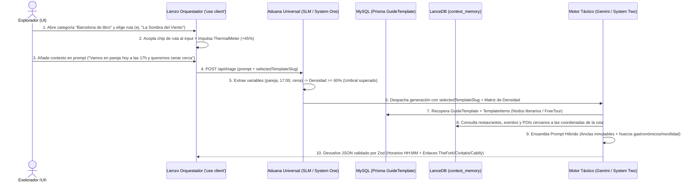

### [ARQUITECTURA] Historia de Usuario: Motor Híbrido de Rutas Predefinidas ("Barcelona de libro") e Inyección Contextual en Orquestador
**Identificador:** HU-19
**Estatus:** Refinado / Listo para Desglose en PBIs
**Fecha de Emisión:** 2026-10-14
**Autor:** Vértice Biológico (Racso) & Tormentosa (Protocolo de Acero S+ Grade)[cite: 19]
**Referencias Normativas:** `CONSTITUTION.md` · `ADR-001 (Vertical Slicing)` · `ESTUDIO-CTX-002`[cite: 19, 21]

--------------------------------------------------------------------------------

#### Matriz de Indexación Tridimensional
* **Naturaleza:** Especificación Funcional y Arquitectónica de Motor Híbrido (Templates Estáticos + Orquestación Generativa), Gobernanza de Fuentes Curadas y Monetización Asimétrica CPA/CPS[cite: 19, 22, 23, 27].
* **Entorno:** Monolito Next.js (App Router) + Microservicio `ia-gateway` (Hono) + Persistencia Híbrida (`MySQL/Prisma` + `LanceDB`) en Nodo 11[cite: 19, 30].
* **Entropía Asimilada:** Destilado de la fricción simbiótica directa[cite: 10]. Evolución de los templates estáticos (`HU-9`) hacia un sistema de anclaje conversacional donde la selección de una ruta temática predefinida (iniciando con *"Barcelona de libro"*) se acopla al prompt del usuario, impulsa la Matriz de Densidad Polimórfica y guía al LLM pesado (`System Two`) para enlazar paradas literarias o FreeTours con servicios gastronómicos y de movilidad en tiempo real[cite: 19, 22, 23, 27].

--------------------------------------------------------------------------------

#### 1. Descripción General
**Como** Explorador / Usuario de BarcelonaXplorer,
**Quiero** poder explorar y seleccionar rutas temáticas predefinidas —comenzando por la categoría **"Barcelona de libro"** con itinerarios basados en obras literarias ambientadas en Barcelona, tanto en modalidad de recorrido autoguiado paso a paso como en modalidad de servicio de FreeTour/visita guiada contratable— para que mi selección se integre directamente en mi prompt de conversación[cite: 23, 27],
**Para** superar la parálisis por análisis y obtener un itinerario cronológico, ejecutable y personalizado donde el orquestador respete los escenarios literarios (o el horario del tour contratado) y los enlace orgánicamente con recomendaciones de restaurantes cercanos, advertencias tácticas (`Escudo Anti-Trampas`) y opciones de transporte según mi contexto personal[cite: 19, 22, 23, 27].

--------------------------------------------------------------------------------

#### 2. Gobernanza de Fuentes de Información y Relación con Fuentes Existentes (`context-sources`)

##### 2.1. Diagnóstico Arquitectónico: ¿Se tratan igual que `src/features/context-sources/`?
**Veredicto de Arquitectura:** Se desacopla la persistencia y el contrato de ingesta respecto a `context-sources`, pero se unifica el **patrón de aprovisionamiento declarativo mediante semilla YAML validada con Zod**[cite: 19, 21].

1. **Incompatibilidad con el Pipeline Vectorial Efímero (`context_memory`):**
   * El subsistema `src/features/context-sources/` está diseñado bajo la premisa de `1 petición HTTP → N ítems atómicos (Clase G0)` con caducidad temporal (`expiresAt` / TTL) y un `summary` restringido a 10–1.200 caracteres en `LanceDB`[cite: 21].
   * Como demostró empíricamente el diagnóstico `ESTUDIO-CTX-002`, inyectar estructuras compuestas o listados de paradas en `context_memory` provoca polución semántica por **Contenedores de Datos (`Clase G2`)** o **Agregadores Editoriales (`Clase G4`)**[cite: 21].
   * Una ruta literaria posee **orden secuencial inmutable** (el hilo narrativo de los capítulos) y vocación **permanente** (no caduca como un evento de agenda cultural)[cite: 21, 22].
2. **Convergencia en el Modelo Relacional (`src/features/guide-templates/`):**
   * Las rutas temáticas predefinidas deben residir en la estructura relacional `MySQL / Prisma` creada en `HU-9`: `TemplateCategory` -> `GuideTemplate` -> `TemplateItem`[cite: 19, 22].
   * Al igual que `context-sources.seed.yml` gobierna las fuentes dinámicas, se instituye el catálogo declarativo `guide-templates.seed.yml` para aprovisionar e hidratar de forma idempotente las categorías temáticas y sus rutas sin bifurcaciones imperativas[cite: 21].

##### 2.2. Matriz de Orígenes de Datos para la Categoría "Barcelona de libro"
La obtención y preparación de la información para poblar `guide-templates.seed.yml` se estructura en cuatro canales verificables:

| Vector de Fuente | Origen de Datos | Modalidad Objetivo | Datos Extraídos y Tratamiento |
| :--- | :--- | :--- | :--- |
| **1. Cartografía Municipal e Institucional** | Open Data Ajuntament de Barcelona (`CKAN` / mapas de *Barcelona Ciutat de la Literatura UNESCO* y `MUHBA`)[cite: 21]. | `SELF_GUIDED_ITINERARY` | Nombres oficiales de vías/espacios, distritos (`addresses_district_name`) y coordenadas geodésicas verificadas (`lat`, `lng`) dentro de la caja de Barcelona[cite: 21, 22]. |
| **2. Grafo Patrimonial Abierto** | `Wikidata SPARQL` (reutilizando la infraestructura de consulta de `wikidata-barcelona-monuments`)[cite: 21]. | `SELF_GUIDED_ITINERARY` | Identificadores canónicos de edificios históricos, placas literarias y monumentos referenciados en las novelas[cite: 21]. |
| **3. Forja Curada S+ (Cero Reserva TDM)** | Destilación editorial interna a partir de las ubicaciones físicas reales de las obras literarias, respetando la Directiva UE 2019/790 (sin *scraping* de prosa con copyright de terceros como TimeOut)[cite: 21, 27]. | Ambas modalidades | Contexto narrativo propio de cada parada, `tactical_metadata` (`Escudo Anti-Trampas` para zonas saturadas como Las Ramblas o el Gótico) y micro-logística peatonal[cite: 22, 27]. |
| **4. Catálogos de Afiliación CPA/CPS** | Plataformas de experiencias (`Civitatis`, `GetYourGuide`, `Tiqets`) alineadas con la **Vía del Fuego**[cite: 23, 27]. | `BOOKABLE_TOUR` (FreeTour / Visita Guiada) | Punto de encuentro (inicio), nodo de cierre del tour, duración estimada, franjas horarias habituales y URL de conversión en `affiliate_refs`[cite: 19, 22, 23, 27]. |

--------------------------------------------------------------------------------

#### 3. Arquitectura de Módulos y Contratos de Datos (Vertical Slicing)

Siguiendo el `ADR-001` y la regla de **Segregación de Barrels** (`AUD-ARCH-BARREL-001`), toda modificación se confina en las verticales funcionales correspondientes, prohibiendo `export *` y aislando la lógica de servidor en `server.ts` con `import 'server-only'`[cite: 19].

```text
src/
├── features/
│   ├── guide-templates/
│   │   ├── guide-templates.seed.yml          # Catálogo semilla declarativo ("Barcelona de libro", etc.)
│   │   ├── guide-template.schema.ts          # Esquemas Zod (SELF_GUIDED_ITINERARY | BOOKABLE_TOUR)
│   │   ├── guide-template-seed.service.ts    # Ingesta idempotente YAML -> Prisma/MySQL
│   │   ├── components/
│   │   │   ├── ThematicCategorySelector.tsx  # Selector táctico de categorías ("Barcelona de libro")
│   │   │   └── RouteTemplatePickerCard.tsx   # Tarjeta de selección e inyección al prompt ('use client')
│   │   ├── index.ts                          # Exportaciones isomorfas (Tipos y Esquemas Zod)
│   │   └── server.ts                         # Casos de uso y repositorio Prisma ('server-only')
│   ├── triage/                               # Extensión de Matriz de Densidad con selectedTemplateSlug
│   └── planner/                              # Ensamblaje híbrido (Template MySQL + RAG LanceDB + LLM)
```

##### 3.1. Evolución del Contrato de Dominio (`guide-template.schema.ts`)
Para soportar tanto rutas descriptivas paso a paso como rutas orientadas a la contratación de un FreeTour, se introduce la discriminación explícita de modalidad mediante `Zod` (tolerancia cero a `any`)[cite: 19, 25]:

```typescript
import { z } from 'zod';

/** Modalidad operativa de la ruta predefinida */
export const TemplateModeSchema = z.enum([
  'SELF_GUIDED_ITINERARY', // Itinerario descriptivo con paradas secuenciales marcadas
  'BOOKABLE_TOUR',         // Descriptivo orientado a reservar FreeTour / Tour Guiado (CPA)
]);

export type TemplateMode = z.infer<typeof TemplateModeSchema>;

/** Metadatos literarios y tácticos de la obra o ruta */
export const LiteraryWorkMetadataSchema = z.object({
  bookTitle: z.string().min(2),
  author: z.string().min(2),
  publicationYear: z.number().int().optional(),
  historicalPeriod: z.string(),
  narrativeHook: z.string().min(20).max(500),
});

/** Esquema de nodo secuencial (TemplateItem) */
export const TemplateWaypointItemSchema = z.object({
  orderIndex: z.number().int().nonnegative(),
  title: z.string().min(2),
  literaryContext: z.string().min(10).max(800),
  locationName: z.string(),
  coordinates: z.object({
    lat: z.number().min(41.30).max(41.47), // Anclaje Geográfico Absoluto Barcelona (HU-1)
    lng: z.number().min(2.05).max(2.23),
  }),
  estimatedDurationMinutes: z.number().int().positive(),
  tacticalMetadata: z.object({
    antiTrapShield: z.string().optional(), // Honestidad radical (Escudo Anti-Trampas)
    microLogistics: z.string().optional(),
  }),
  affiliateRefs: z.array(
    z.object({
      provider: z.enum(['CIVITATIS', 'GETYOURGUIDE', 'TIQETS', 'THEFORK', 'CABIFY']),
      label: z.string(),
      url: z.string().url(),
    })
  ).default([]),
});

/** Contrato de Ruta Predefinida en Semilla */
export const GuideTemplateSeedItemSchema = z.object({
  slug: z.string().regex(/^[a-z0-9-]+$/),
  categorySlug: z.string().regex(/^[a-z0-9-]+$/),
  title: z.string().min(5),
  mode: TemplateModeSchema,
  literaryMetadata: LiteraryWorkMetadataSchema.optional(),
  estimatedTotalDurationMinutes: z.number().int().positive(),
  primaryAffiliateBookingUrl: z.string().url().optional(), // Obligatorio si mode === 'BOOKABLE_TOUR'
  items: z.array(TemplateWaypointItemSchema).min(1),
}).refine(
  (data) => data.mode !== 'BOOKABLE_TOUR' || Boolean(data.primaryAffiliateBookingUrl),
  {
    message: 'Las rutas en modalidad BOOKABLE_TOUR requieren primaryAffiliateBookingUrl obligatoriamente',
    path: ['primaryAffiliateBookingUrl'],
  }
);
```

##### 3.2. Acoplamiento en la Matriz de Densidad Polimórfica (`src/features/triage/`)
Cuando el usuario selecciona una ruta de *"Barcelona de libro"*, la selección no viaja únicamente como texto plano, sino anclada estructuralmente en el sobre de triaje (`OperationEnvelope`)[cite: 19, 22]:
* Se añade el campo opcional `selectedTemplateSlug: string` al payload de la Matriz de Densidad[cite: 19, 22].
* **Impulso Térmico (`ThermalMeter`):** Seleccionar una ruta predefinida aporta de forma instantánea un **+45% de densidad** (ya que resuelve temática, zona geográfica y duración base), situando al usuario al borde o por encima del **Umbral de Supervivencia (60%)** con una sola interacción[cite: 19, 22].

--------------------------------------------------------------------------------

#### 4. Coreografía de Interacción y Flujo de Ingesta en el Prompt



##### Reglas de Ensamblaje para el Motor Generativo (`System Two`)
1. **Caso A — Ruta `SELF_GUIDED_ITINERARY` (Itinerario Marcado):**
   * El caso de uso del `planner` inyecta los `TemplateItem` recuperados de MySQL como **nodos ancla inmutables** en el prompt de sistema del LLM pesado (`Gemini` vía `ia-gateway`)[cite: 19, 22].
   * El LLM tiene prohibido alterar el orden narrativo o inventar escenarios literarios fuera de la plantilla[cite: 22, 25].
   * La misión del LLM es calcular la cronología exacta (`timeSpan.start` y `timeSpan.end` en formato estricto `HH:MM`) e **intercalar nodos de avituallamiento y logística** (ej. reserva de restaurante en `TheFork` al mediodía o al cierre del recorrido, protegida por las advertencias del `Escudo Anti-Trampas`, y drop de `Cabify` en el nodo final por fatiga acumulada)[cite: 19, 22, 23, 27].
2. **Caso B — Ruta `BOOKABLE_TOUR` (FreeTour / Visita Guiada Contratable):**
   * El `planner` bloquea la franja horaria correspondiente a la duración del FreeTour (ej. 120 minutos desde el punto de encuentro hasta el punto de finalización)[cite: 22, 23].
   * Renderiza el bloque del FreeTour con su descripción literaria y el CTA prioritario de reserva (`Civitatis` / `GetYourGuide`)[cite: 23, 27].
   * A partir de las coordenadas del **nodo de finalización del tour** y la hora en que el guía despide al grupo, el orquestador enlaza automáticamente la continuación de la ruta: restaurantes recomendados a menos de 10 minutos a pie (con enlace a `TheFork`), actividades culturales complementarias de `LanceDB` (`context_memory`) y retorno en `Cabify`[cite: 19, 21, 23, 27].

--------------------------------------------------------------------------------

#### 5. Catálogo Semilla Inicial: Categoría "Barcelona de libro" (`guide-templates.seed.yml`)

El archivo de semilla inicializará la categoría `barcelona-de-libro` con un repertorio curado que cubre ambas modalidades operativas[cite: 19, 21, 22]:

```yaml
categories:
  - slug: "barcelona-de-libro"
    name:
      es: "Barcelona de libro"
      ca: "Barcelona de llibre"
      en: "Bookish Barcelona"
    description:
      es: "Recorre los escenarios reales de las grandes novelas ambientadas en Barcelona, a tu aire o con un FreeTour literario."
      ca: "Recorre els escenaris reals de les grans novel·les ambientades a Barcelona, al teu aire o amb un FreeTour literari."
      en: "Walk through the real settings of great novels set in Barcelona, at your own pace or with a literary FreeTour."
    icon: "BookOpen"
    isActive: true

templates:
  # 1. La Sombra del Viento — Modalidad Autoguiada (Itinerario paso a paso marcado)
  - slug: "sombra-del-viento-itinerario"
    categorySlug: "barcelona-de-libro"
    title: "La Sombra del Viento: El Laberinto de los Libros Olvidados"
    mode: "SELF_GUIDED_ITINERARY"
    estimatedTotalDurationMinutes: 150
    literaryMetadata:
      bookTitle: "La Sombra del Viento"
      author: "Carlos Ruiz Zafón"
      publicationYear: 2001
      historicalPeriod: "Barcelona de posguerra (1945)"
      narrativeHook: "Sigue los pasos de Daniel Sempere desde el Arco del Teatro hasta la calle Santa Ana, el Ateneo y Els Quatre Gats."
    items:
      - orderIndex: 0
        title: "Arc del Teatre (El Cementerio de los Libros Olvidados)"
        locationName: "Carrer de l'Arc del Teatre, Ciutat Vella"
        coordinates: { lat: 41.3768, lng: 2.1749 }
        estimatedDurationMinutes: 25
        literaryContext: "Entrada secreta al laberinto donde Isaac custodia los volúmenes rescatados del olvido."
        tacticalMetadata:
          antiTrapShield: "Evita sentarte en las terrazas de La Rambla a 50 metros de aquí: precios inflados y comida congelada. Adéntrate hacia el Raval o espera al tramo de Santa Ana."
          microLogistics: "Tramo estrecho; extrema la precaución con mochilas y bolsillos."
      - orderIndex: 1
        title: "Librería Sempere e Hijos y Els Quatre Gats"
        locationName: "Carrer de Santa Anna / Carrer de Montsió"
        coordinates: { lat: 41.3857, lng: 2.1735 }
        estimatedDurationMinutes: 45
        literaryContext: "El corazón de la vida cotidiana de los Sempere y lugar de tertulia de Gustavo Barceló."
        tacticalMetadata:
          antiTrapShield: "Para comer o cenar cerca de Montsió, reserva mesa previa; los locales sin reserva en la arteria comercial suelen ser franquicias masificadas."
          microLogistics: "A 10 minutos a pie subiendo por La Rambla y girando hacia Portaferrissa."
      - orderIndex: 2
        title: "Plaça de Sant Felip Neri"
        locationName: "Plaça de Sant Felip Neri, Barri Gòtic"
        coordinates: { lat: 41.3834, lng: 2.1752 }
        estimatedDurationMinutes: 30
        literaryContext: "Refugio silencioso en el corazón del Gótico donde convergen las vidas de Nuria Monfort y Julián Carax."
        tacticalMetadata:
          antiTrapShield: "No contrates guías improvisados en los accesos de la Catedral; sigue el trazado hacia el Born para la parada gastronómica."
          microLogistics: "Evita las horas de recreo escolar para experimentar la acústica y quietud real de la plaza."

  # 2. La Sombra del Viento — Modalidad FreeTour Contratable
  - slug: "sombra-del-viento-freetour"
    categorySlug: "barcelona-de-libro"
    title: "FreeTour Oficial de La Sombra del Viento por el Barrio Gótico"
    mode: "BOOKABLE_TOUR"
    estimatedTotalDurationMinutes: 120
    primaryAffiliateBookingUrl: "[https://www.civitatis.com/es/barcelona/free-tour-sombra-viento/](https://www.civitatis.com/es/barcelona/free-tour-sombra-viento/)"
    literaryMetadata:
      bookTitle: "La Sombra del Viento"
      author: "Carlos Ruiz Zafón"
      publicationYear: 2001
      historicalPeriod: "Siglo XX - Posguerra"
      narrativeHook: "Visita guiada por expertos literarios recorriendo los escenarios ocultos de Zafón con reserva gratuita."
    items:
      - orderIndex: 0
        title: "Punto de Encuentro: Plaça de Catalunya / Font de Canaletes"
        locationName: "La Rambla, 133 (Font de Canaletes)"
        coordinates: { lat: 41.3851, lng: 2.1702 }
        estimatedDurationMinutes: 120
        literaryContext: "Inicio del recorrido guiado que atraviesa Santa Anna, Baixada de la Llibreteria y Sant Felip Neri hasta el Born."
        tacticalMetadata:
          antiTrapShield: "Reserva tu plaza con antelación; al terminar el tour en la zona del Born/Santa María del Mar, el orquestador te enlazará con tabernas auténticas fuera del circuito de grupos."
          microLogistics: "Llega 10 minutos antes del inicio. El tour finaliza en el entorno de la Plaza de Sant Felip Neri / Born."
        affiliateRefs:
          - provider: "CIVITATIS"
            label: "Reservar FreeTour Literario (Gratis)"
            url: "[https://www.civitatis.com/es/barcelona/free-tour-sombra-viento/](https://www.civitatis.com/es/barcelona/free-tour-sombra-viento/)"

  # 3. La Catedral del Mar — Modalidad Autoguiada
  - slug: "catedral-del-mar-itinerario"
    categorySlug: "barcelona-de-libro"
    title: "La Catedral del Mar: La Forja de los Bastaixos en el Born"
    mode: "SELF_GUIDED_ITINERARY"
    estimatedTotalDurationMinutes: 120
    literaryMetadata:
      bookTitle: "La Catedral del Mar"
      author: "Ildefonso Falcones"
      publicationYear: 2006
      historicalPeriod: "Barcelona Medieval (Siglo XIV)"
      narrativeHook: "Camina junto a Arnau Estanyol desde las canteras de Montjuïc hasta las piedras de Santa María del Mar y el Carrer Montcada."
    items:
      - orderIndex: 0
        title: "Basílica de Santa María del Mar y Fossar de les Moreres"
        locationName: "Plaça de Santa Maria, 1, El Born"
        coordinates: { lat: 41.3839, lng: 2.1821 }
        estimatedDurationMinutes: 50
        literaryContext: "El templo levantado por el pueblo y los bastaixos piedra a piedra en el barrio de la Ribera."
        tacticalMetadata:
          antiTrapShield: "Las terrazas pegadas a la fachada principal aplican suplementos abusivos; camina dos calles hacia el interior de Sant Pere o princesas secundarias."
          microLogistics: "Revisa los horarios de culto antes de entrar o reserva subida a las terrazas para vistas de 360 grados."
      - orderIndex: 1
        title: "Carrer de Montcada y Plaça del Born"
        locationName: "Carrer de Montcada, El Born"
        coordinates: { lat: 41.3848, lng: 2.1810 }
        estimatedDurationMinutes: 40
        literaryContext: "Arteria de los palacios señoriales y mercaderes donde Arnau consolida su posición como cambista."
        tacticalMetadata:
          antiTrapShield: "Zona ideal para enlazar con cena de autor o tapas históricas reservando previamente por TheFork para evitar colas de más de 45 minutos."
          microLogistics: "Calle peatonal adoquinada de alta densidad; ideal al atardecer."

  # 4. La Plaça del Diamant — Modalidad Autoguiada
  - slug: "placa-del-diamant-gracia"
    categorySlug: "barcelona-de-libro"
    title: "La Plaça del Diamant: El Alma de la Vila de Gràcia"
    mode: "SELF_GUIDED_ITINERARY"
    estimatedTotalDurationMinutes: 110
    literaryMetadata:
      bookTitle: "La plaça del Diamant"
      author: "Mercè Rodoreda"
      publicationYear: 1962
      historicalPeriod: "II República y Guerra Civil (Años 30)"
      narrativeHook: "Adéntrate en el universo de Natàlia (Colometa) y Quimet entre las plazas bohemias y refugios antiaéreos de Gràcia."
    items:
      - orderIndex: 0
        title: "Plaça del Diamant y Estatua de la Colometa"
        locationName: "Plaça del Diamant, Vila de Gràcia"
        coordinates: { lat: 41.4042, lng: 2.1566 }
        estimatedDurationMinutes: 40
        literaryContext: "Escenario del entoldado donde Natàlia conoce a Quimet y donde hoy se conserva el refugio antiaéreo subterráneo."
        tacticalMetadata:
          antiTrapShield: "Gràcia conserva bodegas históricas excelentes; huye de los locales de brunch clónicos de Carrer Gran de Gràcia y prioriza tabernas tradicionales en las calles transversales."
          microLogistics: "Acceso directo desde Metro Fontana (L3) a 3 minutos a pie."
```

--------------------------------------------------------------------------------

#### 6. Normativas Arquitectónicas (Certificación Yunque S+)
1. **Cuarteto de Oráculos Obligatorio (Axioma IV):** Ningún PBI derivado de esta HU podrá darse por cerrado sin superar en verde: `tsc --noEmit`, `eslint --max-warnings 0`, `vitest run` y el empaquetado real `npm run build`[cite: 19].
2. **Parse, don't validate (Axioma II):** Tanto la lectura de `guide-templates.seed.yml` como la salida combinada del orquestador deben ser validadas estrictamente mediante esquemas `Zod` en frontera, garantizando que todos los campos `timeSpan` cumplan el patrón `/^([0-1]?[0-9]|2[0-3]):[0-5][0-9]$/`[cite: 19, 25].
3. **Aislamiento de Bundles:** Los componentes visuales del selector (`ThematicCategorySelector`, `RouteTemplatePickerCard`) jamás importarán servicios de Prisma ni adaptadores de `server.ts`, previniendo regresiones de contaminación de barrels en `/orchestrator`[cite: 19].
4. **Internacionalización Reactiva (`HU-12`):** Las etiquetas de categoría (`"Barcelona de libro"` / `"Barcelona de llibre"` / `"Bookish Barcelona"`) se resolverán según el idioma activo en la cookie del usuario[cite: 19].

--------------------------------------------------------------------------------

#### 7. Criterios de Aceptación (Verificación Empírica)

##### Escenario 1: Aprovisionamiento Idempotente desde Semilla Declarativa YAML
* **Dado** el archivo `src/features/guide-templates/guide-templates.seed.yml` con la categoría `"barcelona-de-libro"` y sus rutas en modalidades `SELF_GUIDED_ITINERARY` y `BOOKABLE_TOUR`.
* **Cuando** se ejecuta el servicio de inicialización/semilla sobre MySQL.
* **Entonces** se persisten sin duplicados los registros en `TemplateCategory`, `GuideTemplate` y `TemplateItem` tras superar la validación `Zod`[cite: 19, 22].
* **Y** si algún registro del YAML contiene coordenadas fuera del perímetro de Barcelona o carece de URL de reserva siendo `BOOKABLE_TOUR`, el proceso falla en frontera devolviendo un `OperationEnvelope` de error tipado[cite: 19, 21, 22].

##### Escenario 2: Selección de Categoría "Barcelona de libro" e Inyección en el Prompt
* **Dado** un usuario en la vista `/orchestrator`[cite: 19].
* **Cuando** despliega la categoría temática `"Barcelona de libro"` y selecciona una ruta (ej. *"La Sombra del Viento"*).
* **Entonces** la interfaz acopla visualmente la ruta seleccionada al cuadro de prompt, permitiendo al usuario escribir contexto adicional antes de enviar (ej. *"Quiero hacerla esta tarde y cenar tapas al acabar"*)[cite: 23, 27].
* **Y** el `ThermalMeter` incrementa inmediatamente su carga reflejando el peso termodinámico de la plantilla seleccionada dentro de la Matriz de Densidad[cite: 19, 22].

##### Escenario 3: Generación Híbrida sobre Ruta con Itinerario Marcado (`SELF_GUIDED_ITINERARY`)
* **Dado** un prompt que incluye una ruta `SELF_GUIDED_ITINERARY` seleccionada y preferencias gastronómicas del usuario.
* **Cuando** la Aduana supera el 60% de densidad y el `planner` invoca al motor pesado (`System Two`)[cite: 19, 22].
* **Entonces** el itinerario generado conserva **íntegramente y en su orden original** todos los nodos literarios del `GuideTemplate`, incluyendo su `Escudo Anti-Trampas` (`tactical_metadata`)[cite: 19, 22, 27].
* **Y** el orquestador intercala nodos reales de restauración y movilidad cercanos a las coordenadas de la ruta (con enlaces CPA a `TheFork` y `Cabify`), con horarios `HH:MM` válidos sin disparar `ZodError`[cite: 19, 22, 23, 27].

##### Escenario 4: Generación Híbrida sobre Ruta de FreeTour Contratable (`BOOKABLE_TOUR`)
* **Dado** un prompt que incluye una ruta `BOOKABLE_TOUR` seleccionada (ej. *"FreeTour de La Sombra del Viento"*).
* **Cuando** el orquestador genera la ruta completa del usuario.
* **Entonces** el itinerario reserva el bloque horario del FreeTour mostrando el punto de encuentro, la descripción literaria y el botón de conversión CPA (`Civitatis` / `GetYourGuide`)[cite: 19, 22, 23, 27].
* **Y** enlaza cronológicamente el final del FreeTour con sugerencias gastronómicas (`TheFork`) y puntos de interés cercanos al nodo donde concluye la visita guiada[cite: 23, 27].

--------------------------------------------------------------------------------

#### 8. Desglose Táctico Propuesto en PBIs (Regla <= 3 Archivos Adyacentes)[cite: 21]
1. **`PBI-TMPL-001` (Contrato Dual y Semilla "Barcelona de libro"):** Evolución de `guide-template.schema.ts`, creación de `guide-templates.seed.yml` e implementación de `guide-template-seed.service.ts` con sus tests unitarios en Vitest[cite: 19].
2. **`PBI-TMPL-002` (Selector UI e Impulso en Matriz de Densidad):** Creación de `ThematicCategorySelector.tsx`, acoplamiento del chip de ruta al prompt en `/orchestrator` e inyección de `selectedTemplateSlug` (+45% de peso térmico) en `src/features/triage/`[cite: 19, 22].
3. **`PBI-TMPL-003` (Ensamblador Híbrido en Planner):** Modificación del caso de uso en `src/features/planner/` para fusionar los nodos inmutables del template de MySQL con el contexto gastronómico/movilidad de `LanceDB` y el prompt de `System Two`[cite: 19, 21, 22].
