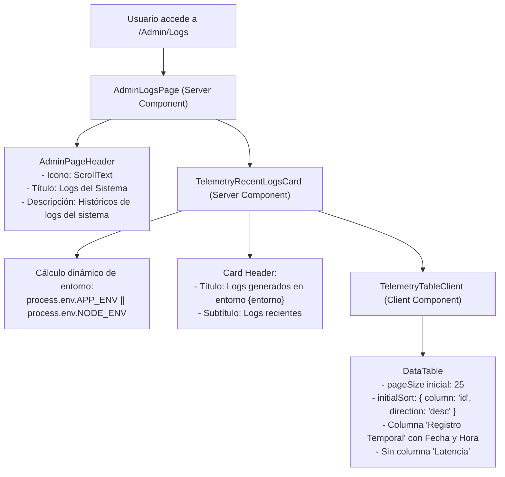

# [OPERATIVO] Documento Destilado: PBI - Refactorización Kaizen y Clarificación Semántica de Logs del Sistema (Admin Logs)

**Identificador:** PBI-UI-KAIZEN-002  
**Estatus:** Completado / Certificado en Producción (S+ Grade)  
**Fecha de Creación:** 2026-10-04  
**Fecha de Certificación:** 2026-10-04  
**Historia de Usuario Relacionada:** [[OPERATIVO] Historia de Usuario: Estabilización Evolutiva y Saneamiento Post-Anclaje v2.0.1](file:///home/racso/Proyectos/BarcelonaXplorer/Documentacion/HistoriasDeUsuario_Historico/%5BOPERATIVO%5D%20Historia%20de%20Usuario:%20Estabilizaci%C3%B3n%20Evolutiva%20y%20Saneamiento%20Post-Anclaje%20v2.0.1.md)  
**Módulo:** Sala de Control Táctica / Administración de Logs ([`src/app/Admin/Logs/`](file:///home/racso/Proyectos/BarcelonaXplorer/src/app/Admin/Logs/), [`src/app/Admin/System/`](file:///home/racso/Proyectos/BarcelonaXplorer/src/app/Admin/System/))  
**Ficheros Modificados:**  
- [`src/app/Admin/Logs/page.tsx`](file:///home/racso/Proyectos/BarcelonaXplorer/src/app/Admin/Logs/page.tsx)  
- [`src/app/Admin/System/TelemetryRecentLogsCard.tsx`](file:///home/racso/Proyectos/BarcelonaXplorer/src/app/Admin/System/TelemetryRecentLogsCard.tsx)  
- [`src/app/Admin/System/TelemetryTableClient.tsx`](file:///home/racso/Proyectos/BarcelonaXplorer/src/app/Admin/System/TelemetryTableClient.tsx)  
- [`src/components/ui/data-table/data-table.tsx`](file:///home/racso/Proyectos/BarcelonaXplorer/src/components/ui/data-table/data-table.tsx)  
- [`src/app/Admin/System/__tests__/TelemetryTableClient.test.tsx`](file:///home/racso/Proyectos/BarcelonaXplorer/src/app/Admin/System/__tests__/TelemetryTableClient.test.tsx)  
**Entorno:** Next.js 16 (App Router), React 19, TypeScript 5.x, Prisma ORM (MySQL), Lucide React  
**Prioridad:** Media (P2 - Higiene Operativa, Clarificación Semántica UX y Ergonomía en Sala de Control)  
**Estimación Táctica:** 2 Story Points  

---

### Matriz de Indexación Tridimensional (Protocolo de Acero)

- **Naturaleza:** Refactorización Kaizen de la vista de auditoría de logs del panel de administración (`/Admin/Logs`), normalización semántica del lenguaje de interfaz hacia términos inteligibles para operadores humanos, reconfiguración de ergonomía visual en la tabla táctica y alineación de iconos canónicos.
- **Entorno:** Componentes de presentación y cliente bajo [`src/app/Admin/Logs/page.tsx`](file:///home/racso/Proyectos/BarcelonaXplorer/src/app/Admin/Logs/page.tsx), [`src/app/Admin/System/TelemetryRecentLogsCard.tsx`](file:///home/racso/Proyectos/BarcelonaXplorer/src/app/Admin/System/TelemetryRecentLogsCard.tsx) y [`src/app/Admin/System/TelemetryTableClient.tsx`](file:///home/racso/Proyectos/BarcelonaXplorer/src/app/Admin/System/TelemetryTableClient.tsx).
- **Entropía Asimilada (Filtros A, B y C):**
  - *Filtro A (Claridad y Usabilidad Semántica):* Erradicación de metáforas crípticas e hiperbólicas innecesarias ("registro sensorial polimórfico", "inspección forense en tiempo real", "bóveda sensorial", "trazabilidad polimórfica desde el Nodo 11") en favor de nomenclatura clara, directa y profesional ("Logs del Sistema", "Históricos de logs del sistema", "Logs generados en entorno {entorno}").
  - *Filtro B (Ergonomía de Datos y Jerarquía Visual):* Supresión de la columna "Latencia" de la tabla principal para evitar sobrecarga cognitiva innecesaria (manteniendo el dato inspeccionable dentro del modal de detalle), e incorporación del timestamp completo (Fecha y Hora `DD/MM/YYYY HH:mm:ss`) bajo la cabecera "Registro Temporal".
  - *Filtro C (Determinismo en Carga y Paginación):* Fijación del orden inicial por defecto en `id` descendente (asegurando correlación estricta de inserción) y establecimiento de 25 registros por página por defecto para maximizar el volumen útil visible sin degradar el rendimiento de renderizado.

---

## 1. Declaración de Intención (INVEST)

**Como** Operador del Sistema y Administrador Técnico (Vértice Biológico),  
**Quiero** normalizar los textos, iconos y estructura de datos de la pantalla `/Admin/Logs`, suprimiendo métricas superfluas de la tabla general y aumentando el muestreo inicial a 25 registros ordenados descendentemente por ID,  
**Para** auditar con rapidez, claridad mental y exactitud temporal los eventos del sistema sin fricción terminológica ni sobrecarga visual.

---

## 2. Diagnóstico del Estado Actual vs. Transformación Kaizen

### 2.1. Tabla Comparativa de Textos y Semántica

| Elemento UI | Texto / Semántica Previa | Implementación Kaizen Certificada | Razón del Cambio |
| :--- | :--- | :--- | :--- |
| **Título Principal (Página)** | `Bitácora de Telemetría` | `Logs del Sistema` | Terminología estándar y directa. |
| **Subtítulo (Página)** | `Registro sensorial polimórfico e inspección forense en tiempo real (MySQL)` | `Históricos de logs del sistema` | Claridad descriptiva sin jerga abstracta. |
| **Icono de Cabecera** | `Terminal` | `ScrollText` (icono canónico de logs/documento) | Mayor correlación semántica con registros y auditoría. |
| **Título de Tarjeta** | `Órgano Sensorial: Bitácora de Telemetría (MySQL)` | `Logs generados en entorno {entorno}` | Clarifica el entorno dinámico activo (`Production`, `Development`, etc.). |
| **Subtítulo de Tarjeta** | `Trazabilidad polimórfica en tiempo real desde el Nodo 11` | `Logs recientes` | Concisión operativa. |
| **Empty State Tabla** | `Bóveda sensorial despejada. No se detectan anomalías...` | `No se encontraron registros de logs para los criterios seleccionados.` | Lenguaje neutro y predecible. |
| **Skeleton Loader** | `Escaneando bóveda sensorial de MySQL...` | `Cargando logs del sistema...` | Coherencia de tono en estados de carga. |

### 2.2. Tabla Comparativa de Comportamiento y Columnas de la Tabla

| Característica | Estado Previo | Implementación Kaizen Certificada |
| :--- | :--- | :--- |
| **Columna Latencia (`durationMs`)** | Visible en la tabla principal (`Latencia`, `XXms`). | **Eliminada de la tabla** (preservada únicamente en el modal de detalle). |
| **Columna Temporal** | Encabezado `Hora`, solo muestra `HH:mm:ss`. | Encabezado **`Registro Temporal`**, muestra fecha y hora completa (`DD/MM/YYYY HH:mm:ss`). |
| **Orden por Defecto** | `createdAt: 'desc'` | **`id: 'desc'`** (determinismo absoluto ante colisiones de segundo en timestamps). |
| **Paginación Inicial** | 10 registros por página (`pageSize={10}`). | **25 registros por página** (`pageSize={25}`, opciones: `[10, 25, 50, 100]`). |

---

## 3. Alcance Táctico y Especificaciones Técnicas



### 3.1. Refactorización en `src/app/Admin/Logs/page.tsx`
- Reemplazado el icono `<Terminal />` por `<ScrollText />` de `lucide-react`.
- Actualizado `title` a `"Logs del Sistema"`.
- Actualizado `description` a `"Históricos de logs del sistema"`.
- Eliminado badge innecesario ("Visión Forense").

### 3.2. Refactorización en `src/app/Admin/System/TelemetryRecentLogsCard.tsx`
- Reemplazado el icono `<Terminal />` por `<ScrollText />` en el encabezado de la tarjeta.
- Obtenido el nombre del entorno dinámico:
  ```ts
  const rawEnv = process.env.APP_ENV || process.env.NODE_ENV || 'production';
  const environmentName = rawEnv.charAt(0).toUpperCase() + rawEnv.slice(1);
  ```
- Título de la tarjeta: `Logs generados en entorno ${environmentName}`.
- Subtítulo: `Logs recientes`.
- Ajustada la consulta Prisma para ordenar deterministamente por `id` descendente (`orderBy: { id: 'desc' }`).
- En el skeleton (`TelemetryRecentLogsCardSkeleton`), actualizado el texto a `"Cargando logs del sistema..."`.

### 3.3. Refactorización en `src/app/Admin/System/TelemetryTableClient.tsx`
- **Eliminación de Latencia:** Retirada la definición de la columna `{ key: 'durationMs', header: 'Latencia' }` del array `columns`.
- **Incorporación de Fecha Completa:**
  - Renombrada cabecera a `'Registro Temporal'`.
  - Mapeado el valor formateado como `DD/MM/YYYY HH:mm:ss`.
  - Configurado `sortable: true` y `accessorFn` cronológico determinista.
- **Orden por defecto:**
  - Configurado `initialSort={{ column: 'id', direction: 'desc' }}`.
- **Paginación:**
  - `pageSize={25}`.
  - `pageSizeOptions={[10, 25, 50, 100]}`.
- **Mensaje de tabla vacía:** Actualizado `emptyMessage` a `"No se encontraron registros de logs para los criterios seleccionados."`.

---

## 4. Criterios de Aceptación (Aduana de Fricción)

- [x] **CA-1 (Cabecera Principal Normalizada):** La página `/Admin/Logs` muestra el título `"Logs del Sistema"`, la descripción `"Históricos de logs del sistema"` y el icono de cabecera representativo de logs (`ScrollText`).
- [x] **CA-2 (Tarjeta y Entorno Dinámico):** La tarjeta de logs muestra el título `"Logs generados en entorno {entorno}"` y el subtítulo `"Logs recientes"`.
- [x] **CA-3 (Erradicación de Latencia en Tabla):** La tabla principal no renderiza la columna de "Latencia". La duración sigue siendo accesible al hacer clic en "Ver" dentro del modal de inspección.
- [x] **CA-4 (Fecha Completa en Registro Temporal):** La columna temporal muestra tanto la fecha como la hora (`DD/MM/YYYY HH:mm:ss`) bajo el título `'Registro Temporal'`.
- [x] **CA-5 (Paginación por Defecto de 25 Elementos):** Al cargar la pantalla, la tabla presenta por defecto 25 filas por página, con el selector de tamaño permitiendo `10, 25, 50, 100`.
- [x] **CA-6 (Orden Inicial por ID Descendente):** Los logs se presentan ordenados inicialmente de manera descendente por `id` (registros más nuevos arriba tanto en Prisma como en cliente).
- [x] **CA-7 (Peaje del Oráculo - Santa Trinidad):**
  - Compilador TypeScript: `npx tsc --noEmit` sin errores (`Exit Code: 0`).
  - Linter AST: `npx eslint` sobre los ficheros modificados sin errores ni advertencias (`Exit Code: 0`).
  - Tests Unitarios: `npm test` ejecuta y aprueba al 100% las suites asociadas (117 suites, 665 tests en verde).

---

## 5. Destino de Forja y Ficheros Afectados

1. [`src/app/Admin/Logs/page.tsx`](file:///home/racso/Proyectos/BarcelonaXplorer/src/app/Admin/Logs/page.tsx): Cabecera de página, título, subtítulo e icono.
2. [`src/app/Admin/System/TelemetryRecentLogsCard.tsx`](file:///home/racso/Proyectos/BarcelonaXplorer/src/app/Admin/System/TelemetryRecentLogsCard.tsx): Título dinámico con entorno, subtítulo, icono, consulta Prisma `orderBy` y texto del skeleton.
3. [`src/app/Admin/System/TelemetryTableClient.tsx`](file:///home/racso/Proyectos/BarcelonaXplorer/src/app/Admin/System/TelemetryTableClient.tsx): Eliminación de columna Latencia, formateo de Fecha en Registro Temporal, orden inicial por ID Desc, pageSize en 25 y textos de empty state.
4. [`src/components/ui/data-table/data-table.tsx`](file:///home/racso/Proyectos/BarcelonaXplorer/src/components/ui/data-table/data-table.tsx): Soporte para ordenación cliente por campos presentes en el registro aunque no formen parte de columnas visibles.
5. [`src/app/Admin/System/__tests__/TelemetryTableClient.test.tsx`](file:///home/racso/Proyectos/BarcelonaXplorer/src/app/Admin/System/__tests__/TelemetryTableClient.test.tsx): Suite de pruebas unitarias actualizada con verificación de cabeceras, formato temporal y paginación.

---

## 6. Verificación y Certificación del Peaje del Oráculo

| Oráculo | Comando de Verificación | Resultado Determinista | Estado |
| :--- | :--- | :--- | :---: |
| **Compilador TypeScript** | `npx tsc --noEmit` | `Exit Code: 0` (0 errores) | ✅ APROBADO |
| **Linter AST** | `npx eslint app/Admin/Logs/page.tsx app/Admin/System/TelemetryRecentLogsCard.tsx app/Admin/System/TelemetryTableClient.tsx app/Admin/System/__tests__/TelemetryTableClient.test.tsx components/ui/data-table/data-table.tsx` | `Exit Code: 0` (0 errores, 0 advertencias) | ✅ APROBADO |
| **Suite Unitaria TelemetryTableClient** | `npm test -- app/Admin/System/__tests__/TelemetryTableClient.test.tsx` | 7/7 tests pasados (100%) | ✅ APROBADO |
| **Suite Global Vitest** | `npm test` | 117/117 suites pasadas, 665/665 tests pasados (100%) | ✅ APROBADO |
